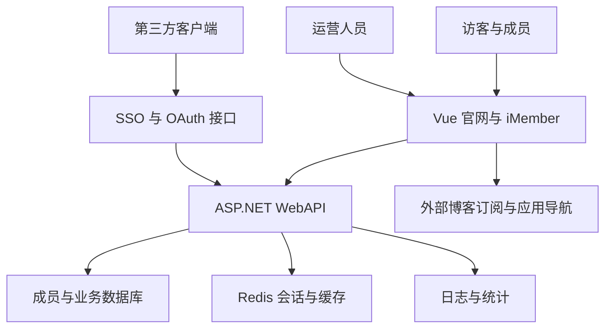

# iOS Club 官网 PRD · 功能现状与冲突梳理

版本 v0.1。日期 2026-10-25。状态为待评审草案。源码基线为 `0d44921`。

修订记录于 2026-10-25。本文保留最初盘点基线。C01 至 C05 后续已在本地修复并通过后端全套测试，当前行为变化见 [P0 修复与 TDD 验证记录](P0修复与TDD验证记录.md)，尚未部署。

## 1. 概要

本项目为西建大 iOS Club 提供官网展示、成员服务、社团运营和统一登录能力。本 PRD 先记录当前代码中的功能，再提出统一规则与修复顺序，供负责人确定范围，供开发者拆分后续工作。

本文中的“已实现”仅表示发现了对应源码，不表示已通过运行验收。当前没有启动网站、连接业务数据库、调用线上接口或验证外部服务。用户尚未提供具体故障案例。问题依据见 [冲突清单](功能冲突与待决策清单.md)，前端和控制器路由声明见 [功能入口索引](功能入口索引.md)。

## 2. 背景与边界

README 和使用说明书描述的功能范围，与当前页面、接口和数据模型不完全一致。例如，说明书描述了评论、我的活动和项目管理，但不能据此认定当前系统支持这些能力。

本轮覆盖前台页面、个人中心、后台管理、认证与第三方接入、运维接口及主要业务规则。交付范围是需求与现状文档，不包含业务修复、数据迁移或部署。

为防止把历史描述当成现状，全文采用以下标记。

| 标记 | 含义 |
| --- | --- |
| 源码存在 | 找到实现入口或调用链，未验证实际运行 |
| 静态冲突 | 调用方、接口或规则之间存在可直接定位的矛盾 |
| 待决策 | 当前实现无法回答应当采用哪条产品规则 |
| 未找到 | 本次检查范围内未找到对应能力，不代表外部系统也没有 |

## 3. 目标与验收口径

本轮目标是建立可追溯的功能基线，避免后续按过期说明书修复功能。以下是建议验收目标，需负责人评审，并非已经完成的运行结果。

1. 每个注册页面和业务控制器均能映射到功能清单，或在入口索引中说明用途。
2. 每个确认的冲突都有受影响角色、操作条件、源码依据和验收条件。
3. 修复批次进入开发前，确定角色权限、账号来源、活动登记含义和备份范围。对应问题见第 7 节。

不把页面可打开、按钮可点击或编译通过单独作为业务验收标准。涉及数据的功能，需要验证保存结果和再次读取结果。

## 4. 用户群与任务

| 用户群 | 主要任务 | 约束 |
| --- | --- | --- |
| 访客与活动参与者 | 了解社团、阅读公开内容、访问工具、填写活动登记 | 匿名登记不等同于创建成员账号 |
| 登录成员与内容维护者 | 维护个人资料、读取获准内容、按权限维护文章 | Member 与 Department 不是同一角色 |
| 运营与系统管理者 | 维护成员和部门、组织活动、管理应用接入、排查问题 | Founder、President、Minister 的实际权限存在重叠和冲突 |

## 5. 用户价值

下表中的替代方式是需求分析假设，尚未访谈确认。当前方式依据本次源码检查。

| 用户群 | 为什么使用 | 当前方式与问题 | 本次方案 | 预期结果 | 替代方式假设 |
| --- | --- | --- | --- | --- | --- |
| 访客与活动参与者 | 找到可信的社团信息并确认登记结果 | 静态活动介绍与后台登记分离，登记前看不到活动摘要 | 明确展示内容与登记活动的关系，定义成功、关闭和重复登记反馈 | 知道登记的是哪场活动，是否成功 | 群公告、人工登记表 |
| 登录成员与内容维护者 | 维护资料并阅读或维护获准文章 | 登录态、菜单和接口权限不完全一致 | 统一会话和内容访问规则，分清公开博客与本站文章 | 可见内容和可执行操作一致 | 管理员代改、外部博客 |
| 运营与系统管理者 | 可靠地维护人员和活动数据 | 新增、编辑、角色变更、备份存在冲突 | 建立功能清单、权限矩阵、备份清单及逐项验收条件 | 操作影响可预测，失败可识别，恢复范围可核对 | 表格维护、人工备份 |

对使用者，目标是让界面承诺与实际结果一致。对维护者，目标是让每条修复都能追溯到明确规则和验收场景。

## 6. 当前功能全景

### 6.1 系统如何协作

页面入口集中在 [router.ts](../frontend/src/router.ts)。权限由接口特性及部分仓库规则共同决定。前端隐藏菜单不是接口授权。

学院选项和按身份分支的用户概览由 [InfoController.cs](../rearend/iOSClub.WebAPI/iOSClub.WebAPI/Controllers/InfoController.cs) 提供。GZipServer 是压缩工具，不是独立 HTTP 控制器。客户端埋点与外部分析配置属于运行支持，不作为独立业务能力。

### 6.2 前台展示与公共入口

| ID | 功能与入口 | 当前行为 | 状态与边界 | 主要源码 |
| --- | --- | --- | --- | --- |
| F01 | 首页 `/` | 社团介绍、导航与展示 | 源码存在 | [Home.vue](../frontend/src/pages/Home.vue) |
| F02 | 社团项目 `/projects` | 静态项目卡片和外部仓库跳转 | 未找到独立项目管理后台或当前项目 CRUD 接口 | [Projects.vue](../frontend/src/pages/ClubActivities/Projects.vue) |
| F03 | 活动介绍 `/event` | 静态活动类别及相关文章链接 | 不读取后台活动列表 | [Event.vue](../frontend/src/pages/ClubActivities/Event.vue) |
| F04 | 社团历史 `/History` | 社团发展内容展示 | 源码存在 | [History.vue](../frontend/src/pages/ClubActivities/History.vue) |
| F05 | 应用导航 `/Tools` | 读取外部导航服务并打开应用 | 外部可用性未验证，与内部资源不同源 | [ToolService.ts](../frontend/src/services/ToolService.ts) |
| F06 | 社团博客 `/Blog` | 聚合外部 RSS、Atom 内容并跳转 | 不等于本站文章列表 | [RssService.ts](../frontend/src/services/RssService.ts) |
| F07 | 关于我们、社团结构、其他组织 | `/About`、`/Structure`、`/OtherOrg` | 前两页使用固定文章路径 | [Articles 目录](../frontend/src/pages/Articles) |
| F08 | 文章 `/article/:id` | Markdown 阅读、分类目录、代码与图表渲染 | 可见性由后端控制，分类列表存在冲突 | [Article.vue](../frontend/src/pages/Articles/Article.vue)、[MenuContent.vue](../frontend/src/components/MenuContent.vue) |
| F09 | 加群、帮助、隐私与错误页 | 二维码、说明、拒绝访问、404 | 信息页存在，文案不等于能力证明 | [router.ts](../frontend/src/router.ts) |
| F10 | 匿名登记 `/ActivityRegister/:id` | 姓名、学号、学院、班级登记与结果反馈 | 不预取活动摘要，不提供我的活动或取消入口 | [ActivityRegister.vue](../frontend/src/pages/ActivityRegister.vue) |
| F11 | 全站体验 | 响应式布局、移动侧栏、深浅与系统主题 | 源码存在，设备体验未验收 | [Sidebar.vue](../frontend/src/components/Sidebar.vue)、[theme.ts](../frontend/src/stores/theme.ts) |

### 6.3 账号与个人中心

| ID | 功能与入口 | 当前行为 | 状态与边界 | 主要源码 |
| --- | --- | --- | --- | --- |
| F12 | 注册 `/signup` | 学生档案注册、学院选项与建立登录态 | 注册字段不能按旧说明书认定为邮箱注册 | [SignUp.vue](../frontend/src/pages/LoginSys/SignUp.vue)、[AuthController.cs](../rearend/iOSClub.WebAPI/iOSClub.WebAPI/Controllers/AuthController.cs) |
| F13 | 登录 `/login` | 学号密码、记住登录、保存访问与刷新令牌 | 干部备用登录存在 P0 冲突 | [AuthService.ts](../frontend/src/services/AuthService.ts)、[LoginService.cs](../rearend/iOSClub.WebAPI/iOSClub.DataApi/Services/LoginService.cs) |
| F14 | 会话维护与退出 | 验证、自动刷新、登出 | 前端状态同步和后端撤销规则存在冲突 | [Authorization.ts](../frontend/src/stores/Authorization.ts)、[ApiService.ts](../frontend/src/services/ApiService.ts) |
| F15 | 找回与修改密码 | 学号申请邮件验证码、重置密码、登录后改密 | 依赖档案邮箱及邮件服务，送达未验证 | [ForgotPassword.vue](../frontend/src/pages/LoginSys/ForgotPassword.vue)、[AuthController.cs](../rearend/iOSClub.WebAPI/iOSClub.WebAPI/Controllers/AuthController.cs) |
| F16 | 概览 `/Centre` | 个人信息、工具与管理者统计 | 统计失败会显示固定示例数字 | [Centre.vue](../frontend/src/adminPages/Centre.vue) |
| F17 | 个人资料 `/Centre/PersonalData` | 查询与编辑学生档案、修改密码 | 档案更新与密码修改为独立流程，未找到头像上传能力 | [PersonalData.vue](../frontend/src/adminPages/PersonalData.vue)、[UserController.cs](../rearend/iOSClub.WebAPI/iOSClub.WebAPI/Controllers/UserController.cs) |

### 6.4 成员、部门与组织运营

| ID | 功能与入口 | 当前行为 | 状态与边界 | 主要源码 |
| --- | --- | --- | --- | --- |
| F18 | 成员查询 `/Centre/MemberData` | 列表、分页、搜索、统计图、全部与在校名单导出 | 在校口径需负责人确认 | [MemberData.vue](../frontend/src/adminPages/MemberData.vue)、[MemberQueryController.cs](../rearend/iOSClub.WebAPI/iOSClub.WebAPI/Controllers/MemberQueryController.cs) |
| F19 | 成员维护 | 编辑、删除、JSON 批量更新、管理员重置密码 | 新增入口调用更新接口，编辑后的本地列表定位有误 | [MemberManagementController.cs](../rearend/iOSClub.WebAPI/iOSClub.WebAPI/Controllers/MemberManagementController.cs) |
| F20 | 部门维护 `/Centre/Department` | 查询、创建、更新、删除和导出部门 | 创建删除比更新权限更高 | [DerpartmentControllers.cs](../rearend/iOSClub.WebAPI/iOSClub.WebAPI/Controllers/DerpartmentControllers.cs) |
| F21 | 干部与部门关系 | 干部查询、增改删、按身份查询、调部门、任命 | 普通维护接口可改角色，与专用权限入口冲突 | [StaffController.cs](../rearend/iOSClub.WebAPI/iOSClub.WebAPI/Controllers/StaffController.cs)、[StaffRepository.cs](../rearend/iOSClub.WebAPI/iOSClub.DataApi/Repositories/StaffRepository.cs) |
| F22 | 部门名单导入 | JSON、Excel、CSV 解析预览，校验，覆盖名单，保存历史与导入前备份，下载备份和回滚 | 跨部门迁移、Founder 保护、President 归属存在规则问题 | [Department.vue](../frontend/src/adminPages/Department.vue)、[DepartmentImportService.cs](../rearend/iOSClub.WebAPI/iOSClub.WebAPI/Services/DepartmentImportService.cs) |
| F23 | 创始人权限 `/Centre/FounderPermission` | 搜索成员、调整角色和部门 | 专用入口限 Founder，但并非所有变更路径都使用同一保护 | [FounderPermissionController.cs](../rearend/iOSClub.WebAPI/iOSClub.WebAPI/Controllers/FounderPermissionController.cs) |

### 6.5 内容、资源与活动

| ID | 功能与入口 | 当前行为 | 状态与边界 | 主要源码 |
| --- | --- | --- | --- | --- |
| F24 | 文章后台 `/Centre/Article` | 查询、创建、编辑、删除，Markdown 导入导出与预览，设置分类、最低身份及可见部门 | 编辑权限不按作者所有权定义，没有审核或废纸篓能力证明 | [ArticleEditor.vue](../frontend/src/adminPages/Article/ArticleEditor.vue)、[ArticleControllers.cs](../rearend/iOSClub.WebAPI/iOSClub.WebAPI/Controllers/ArticleControllers.cs) |
| F25 | 文章检索与排序 | 搜索高亮、分类查询、批量文章顺序更新 | 读取和写入需统一可见性规则 | [ArticleAccessPolicy.cs](../rearend/iOSClub.WebAPI/iOSClub.DataApi/Repositories/ArticleAccessPolicy.cs) |
| F26 | 分类 `/Centre/Category` | 分类查询、增改删、排序、分类内文章顺序维护 | 分类写权限限 Founder、President，部长可见界面需调整 | [CategoryController.cs](../rearend/iOSClub.WebAPI/iOSClub.WebAPI/Controllers/CategoryController.cs) |
| F27 | 内部资源 `/Centre/Resources` | 列表、详情、名称搜索、按标签查询、标签列表、统计、增改删 | 读取要求存在 Staff 且为 Department 及以上，Member 不可读。写入需管理角色，菜单更严格 | [ResourceControllers.cs](../rearend/iOSClub.WebAPI/iOSClub.WebAPI/Controllers/ResourceControllers.cs) |
| F28 | 活动 `/Centre/Activity` | 按名称和状态查询、创建、编辑、删除、手动切换状态、定时自动流转 | 与前台静态活动介绍分离 | [ActivityController.cs](../rearend/iOSClub.WebAPI/iOSClub.WebAPI/Controllers/ActivityController.cs)、[ActivityAutoStatusService.cs](../rearend/iOSClub.WebAPI/iOSClub.DataApi/Services/ActivityAutoStatusService.cs) |
| F29 | 活动登记通道 | 管理者开关、自助链接和二维码、匿名登记 | 当前更接近参与信息登记，未找到独立报名审批、签到核验或候补规则 | [ActivityDetail.vue](../frontend/src/adminPages/Activity/ActivityDetail.vue) |
| F30 | 活动参与者 | 分页、搜索、学院筛选、添加、编辑、删除、批量删除、重复学号检查 | 名单不等同于会员账号 | [ActivityParticipantRepository.cs](../rearend/iOSClub.WebAPI/iOSClub.DataApi/Repositories/ActivityParticipantRepository.cs) |
| F31 | 活动文件与记录 | Excel 模板、导入预览、错误报告、名单导出、删除前备份与操作日志 | 导出备份不等于已实现一键恢复 | [ActivityExcelService.cs](../rearend/iOSClub.WebAPI/iOSClub.DataApi/Services/ActivityExcelService.cs)、[ActivityController.cs](../rearend/iOSClub.WebAPI/iOSClub.WebAPI/Controllers/ActivityController.cs) |

### 6.6 系统、数据与第三方接入

| ID | 功能与入口 | 当前行为 | 状态与边界 | 主要源码 |
| --- | --- | --- | --- | --- |
| F32 | 数据中心 `/Centre/Admin` | 成员年度、学院、年级、政治面貌、性别与总数统计 | 指标口径需固定，失败不应显示示例值 | [DataCentreController.cs](../rearend/iOSClub.WebAPI/iOSClub.WebAPI/Controllers/DataCentreController.cs) |
| F33 | JSON 数据交换 | 按形状导入成员等数据，返回新增、更新和跳过数量，导出 JSON | “完整备份”名义与实际范围不符 | [DataCentreService.cs](../rearend/iOSClub.WebAPI/iOSClub.DataApi/Services/DataCentreService.cs) |
| F34 | 抹除数据入口 | 前端有确认框及远程 DELETE 请求 | 当前仓库未找到对应后端接口，不计为可用能力 | [Admin.vue](../frontend/src/adminPages/Admin.vue) |
| F35 | 客户端应用 `/Centre/Client` | 查询、创建、更新、删除、复制客户端信息，后端支持重新生成密钥 | 与 SSO 重定向地址、密钥和权限范围共同验收 | [ClientAppController.cs](../rearend/iOSClub.WebAPI/iOSClub.WebAPI/Controllers/ClientAppController.cs) |
| F36 | 统一身份 SSO | discovery、JWKS、授权、回调、授权码换令牌、userinfo、主站会话接入、客户端信息 | 返回刷新令牌，但 token 端点未支持刷新授权。账号兼容性及 JSON 协议存在冲突，未证明完整 OIDC 合规 | [SSOController.cs](../rearend/iOSClub.WebAPI/iOSClub.WebAPI/Controllers/SSOController.cs) |
| F37 | OAuth 辅助入口 | login、callback、exchange、logout、拒绝访问反馈 | 与 SSO 共存，认证方案配置需运行复现 | [OAuthController.cs](../rearend/iOSClub.WebAPI/iOSClub.WebAPI/Controllers/OAuthController.cs) |
| F38 | 系统日志 `/Centre/Logs` | 分页筛选、统计、时间分布、清理旧日志 | 后端仅要求登录，与管理菜单权限不一致 | [LogsController.cs](../rearend/iOSClub.WebAPI/iOSClub.WebAPI/Controllers/LogsController.cs) |
| F39 | 运行与访问监控 | 运行指标、HTTP 统计、数据访问和变更统计、重置统计，Prometheus 与 Grafana 配置 | 监控接口未限制身份，是否由网关隔离未验证 | [MonitoringController.cs](../rearend/iOSClub.WebAPI/iOSClub.WebAPI/Controllers/MonitoringController.cs)、[docker-compose.yml](../docker-compose.yml) |
| F40 | IP 与请求防护 | 黑名单统计、添加、移除、检查、刷新，限流、脱敏与统一错误响应 | 配置和中间件存在，效果未做运行验收 | [IpBlacklistController.cs](../rearend/iOSClub.WebAPI/iOSClub.WebAPI/Controllers/IpBlacklistController.cs)、[Program.cs](../rearend/iOSClub.WebAPI/iOSClub.WebAPI/Program.cs) |
| F41 | 会话缓存清理 | `GET /clean` 清理登录、刷新等 Redis 键 | 无接口身份要求，列为 P0 | [CacheController.cs](../rearend/iOSClub.WebAPI/iOSClub.WebAPI/Controllers/CacheController.cs) |

### 6.7 当前主要权限矩阵

下表记录接口现状，不代表推荐权限。F、P、M 分别为 Founder、President、Minister。Department 表示部门成员角色。

| 操作 | 访客 | Member | Department | M | P | F |
| --- | --- | --- | --- | --- | --- | --- |
| 阅读文章详情 | 按文章规则 | 按文章规则 | 按文章规则 | 按文章规则 | 按文章规则 | 按文章规则 |
| 文章后台及增改删 | 否 | 否 | 是，受文章可见性限制 | 同左 | 同左 | 同左 |
| 分类查询、分类文章列表 | 是，列表过滤有冲突 | 是 | 是 | 是 | 是 | 是 |
| 分类创建、删除与分类顺序 | 否 | 否 | 否 | 否 | 是 | 是 |
| 内部资源读取 | 否 | 否 | 是，要求 Staff 记录 | 同左 | 同左 | 同左 |
| 成员、干部、活动、客户端管理 | 否 | 否 | 否 | 是 | 是 | 是 |
| 部门详情读取 | 否 | 否 | 仅本部门 | 可指定部门 | 可指定部门 | 可指定部门 |
| 全部部门列表、更新与名单导入回滚 | 否 | 否 | 否 | 是 | 是 | 是 |
| 创建与删除部门 | 否 | 否 | 否 | 否 | 是 | 是 |
| Founder 专用角色变更 | 否 | 否 | 否 | 否 | 否 | 是 |
| 日志读取与清理 | 否 | 是 | 是 | 是 | 是 | 是 |
| 监控与重置统计、缓存清理 | 是 | 是 | 是 | 是 | 是 | 是 |

文章还有最低身份和可见部门限制。Member 限制与匿名访问的实际判定存在特殊分支，不能仅由名称推断“必须登录”。其产品含义需评审。[判定源码](../rearend/iOSClub.WebAPI/iOSClub.DataApi/Repositories/ArticleAccessPolicy.cs#L79)。

### 6.8 数据与状态规则

- Student 保存档案和密码，Staff 保存干部身份和部门，通过学号关联。存在只保存 Staff 的兼容路径，因此不能假定每个可登录者都有完整学生档案。
- 个人资料更新与改密分离。现有 [StudentRepositoryTests.cs](../rearend/iOSClub.WebAPI/iOSClub.Tests/RepositoryTests/StudentRepositoryTests.cs) 已包含更新档案不改密码、改密后旧密码失效的断言。本轮未运行这些测试。
- 文章创建和更新会校验最低身份值，禁止将阅读职级设为高于操作者，并校验指定部门是否存在。编辑和删除已有文章还需通过现有文章可见性判断。[文章控制器](../rearend/iOSClub.WebAPI/iOSClub.WebAPI/Controllers/ArticleControllers.cs#L68)。
- 活动自动流转为 Upcoming 到 Ongoing，再到 Finished。后台任务按源码配置每 15 秒检查，不承诺整点立即变化。管理员可手动设置状态，后续仍可能被时间规则推进。
- 切换为 Ongoing 会开启自助登记，切到其他状态会关闭。独立开关还能再次改变登记状态。因此需明确“活动状态”与“是否允许登记”是两个概念。[活动仓库](../rearend/iOSClub.WebAPI/iOSClub.DataApi/Repositories/ActivityRepository.cs)。
- 部门导入是名单覆盖，不是只追加。未出现在新名单中的原部门 Staff 会被移除，学生档案保留。导入还可能移动其他部门的同学，需在产品规则中明确提示和授权。
- 活动名单按活动和学号建立唯一约束。Excel 导入区分有效行和错误行，合格行逐条写入，不能承诺整批原子成功。重复点击和部分成功的反馈需要运行验收。[活动控制器](../rearend/iOSClub.WebAPI/iOSClub.WebAPI/Controllers/ActivityController.cs#L246)、[数据约束](../rearend/iOSClub.WebAPI/iOSClub.Data/ClubContext.cs#L86)。
- 全量 JSON 交换、部门名单快照和活动 Excel 是不同的数据交换机制，不得统称为可恢复整个系统的备份。

## 7. 建议需求与待决策事项

### 7.1 首批需求

| ID | 建议需求 | 验收条件 | 对应冲突 |
| --- | --- | --- | --- |
| R01 | 所有登录路径验证真实凭证 | 姓名与学号组合不能代替密码，合法账号可正常登录 | C01 |
| R02 | 统一角色变更保护 | 常规编辑、部门导入和专用角色接口均不能绕过 Founder 保护 | C02、C03 |
| R03 | 统一会话与管理权限 | 登出或撤销后旧凭证被拒绝，普通成员不能清日志，匿名不能清会话与重置统计 | C04 至 C07、C13 |
| R04 | 统一文章可见性 | 分类列表、检索、目录和详情对同一用户得到一致结果，隐藏文章不泄露标题 | C08 |
| R05 | 修复成员维护闭环 | 新增按确认规则创建账号，编辑只改变目标学号对应行，刷新后结果一致 | C09、C10 |
| R06 | 明确备份范围并验证恢复 | 正常管理员可导出，列出覆盖与排除项，在隔离数据集中验证恢复一致性 | C11、C12 |
| R07 | 失败状态显示真实结果 | 统计失败显示不可用与重试，不显示示例数据，删除反馈与恢复能力一致 | C14、C16 |
| R08 | 明确权限较低者的只读界面 | 菜单、按钮、直达页面和接口操作符合确认后的权限矩阵 | C15 |

### 7.2 必须由负责人确定的规则

| ID | 问题 | 建议默认方向，尚未批准 |
| --- | --- | --- |
| D01 | 部长能管理全部成员，还是只管理本部门？ | 先明确跨部门授权边界，再统一查询、导入、导出和写操作 |
| D02 | 管理员是否可以新增成员账号？ | 若保留新增，定义初始凭证、首次改密和通知。否则删除误导入口 |
| D03 | 匿名能否看到标记为 Member 的文章？ | 将公开与需登录明确区分，不依赖角色名称猜测 |
| D04 | 前台活动是否展示后台活动？登记是报名还是签到？ | 先定义登记业务含义，再决定公开活动摘要、名单权限和取消规则 |
| D05 | 外部博客与本站文章如何命名？应用导航与内部资源如何命名？ | 保留不同数据来源，在导航和后台中明确区分 |
| D06 | President 能否属于部门？跨部门导入能否转移角色？ | 各写入口使用同一规则，跨部门变更必须在预览中说明 |
| D07 | “完整备份”到底覆盖哪些实体？是否允许全库抹除？ | 先实现可验证的备份契约，抹除入口在定义完成前不作为可用能力 |
| D08 | 只存在 Staff 的账号是否继续受支持？ | 主站、刷新、SSO 使用相同账号模型，迁移方式另行评审 |
| D09 | 在校成员如何判定？退社和毕业如何处理？ | 固定年级、学制及特殊情况口径，导出与统计保持一致 |

### 7.3 未找到实现的历史描述

在当前路由和控制器范围，未找到文章评论、活动留言、我的活动与取消参与、按作者管理我的文章、头像上传、独立项目 CRUD、文章废纸篓和恢复流程。旧说明书中这些描述需撤回或转为后续需求，不能列入已交付能力。

### 7.4 仍需补充的证据

用户实际故障步骤、部署版本与反向代理路由、真实角色样本、外部订阅和导航服务状态、邮件送达、SSO 客户端实际协议及数据库恢复结果均未验证。源码冲突不会自动等于线上已经被触发。

## 8. 修复批次与评审方式

| 批次 | 建议范围 | 进入下一批的条件 |
| --- | --- | --- |
| 需求评审 | 确认 D01 至 D09，补充用户已遇到的问题 | 每条规则有结论，每个问题有验收场景 |
| 首批修复 | C01 至 C08 的认证、权限和内容暴露问题 | 直接请求接口也符合权限规则，旧凭证撤销场景通过 |
| 第二批修复 | 成员新增编辑、备份导出与恢复、登录态、统计和界面反馈 | 完整操作链及再次读取验证通过 |
| 后续迭代 | 前台活动摘要、功能命名、SSO 兼容与文档修订 | 与负责人确认的业务范围一致 |

不在本轮承诺新评论系统、项目管理、文章审核、活动审批或全面重构。没有估算工期，实施规模取决于规则评审和运行复现结果。本次不提交代码修复，也不执行数据清理。

现有测试覆盖了部分仓库、认证、文章权限、部门导入和导出流程。它们不构成整个项目已经可用的证据。后续验收应在隔离环境验证关键角色和完整用户操作链。

维护功能索引时运行 `python3 docs/tools/inventory_features.py`。该脚本只生成源码声明索引，功能含义、冲突结论和验收结果仍需人工核对。
