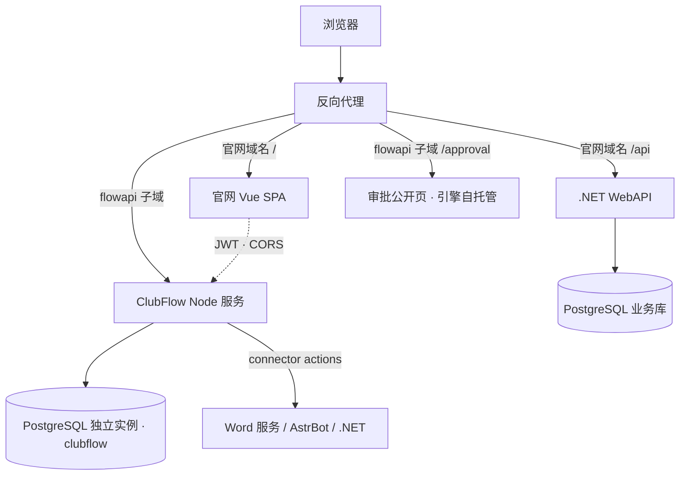

# ClubFlow · 通用工作流引擎 · 产品需求文档（PRD）

| 项目 | 内容 |
|---|---|
| 产品名称 | ClubFlow 通用工作流引擎 |
| 代号 | `clubflow` |
| 归属 | 西建大 iOS Club |
| 承载形态 | 独立 Node 服务（TypeScript）+ 官网后台 Vue 3 模块 + 引擎自托管审批页 |
| 存储 | PostgreSQL（独立 database `clubflow`，复用现有实例） |
| 文档版本 | v0.10（草案） |
| 日期 | 2026-11-01 |
| 状态 | 待评审 |

**版本历史**

| 版本 | 日期 | 变更 |
|---|---|---|
| v0.1 | 2026-11-01 | 首版。确定仅 HTTP 工具、含人工审批节点、不做 Git 同步 |
| v0.2 | 2026-11-01 | 按评审修订：条件分支改用 `on` 标记出口；试运行与演练分两种模式；会签/或签补多审批人与每人一条 token；审批唤醒改为 CAS 推进 + 扫描兜底；SSRF 与白名单收紧；幂等键定义作用域；补密钥轮换与脱敏清单；表达式统一 `{{ }}`；验收补齐承诺项 |
| v0.3 | 2026-11-01 | 技术栈由 Go 改为 TypeScript（Node 22 + Fastify + Prisma + zod）；存储由 MongoDB 改为 PostgreSQL；新增「身份、登录与权限」章节与部署拓扑；删除 YAML 顺序风险；补选型备忘 |
| v0.4 | 2026-11-01 | 按源码与实测评测核实官网 JWT：角色值域为五级（无 Admin）、role claim 是长 URI、`alg` 是 XML-DSig URI、access token 与 JWKS 用的是两把密钥；§6.2 改为实测结论并给出验签方案；新增附录 E 实测记录 |
| v0.5 | 2026-11-01 | 引擎准入限定为 Founder / President / Minister 三档，三者均为管理员；tool 升级为 connector（出站 actions + 入站 triggers 共用凭证与白名单，验签幂等仍在核心）；验签方案定为 A（引擎自验，不改 .NET） |
| v0.6 | 2026-11-01 | 准入放宽到 rank ≥ 20：Department 作为引擎成员（member）只读，可看流程与运行、可提交被指派的审批决定；`admin` 仍为 rank ≥ 30；Member(10) 不开放 |
| v0.7 | 2026-11-01 | 确认准入阈值固定在 rank ≥ 20，`Member`(10) 不开放且不设例外名单；关闭开放问题并重排编号 |
| v0.8 | 2026-11-01 | 后台路由定为 `/Centre/Flow`；API 走独立子域 `flowapi.<域名>`（补跨域方案）；PostgreSQL 改独立实例；事件保留 90 天确认满足审计；学管链接、审批人联系方式、webhook 触发归入 connector；开放问题收敛到 3 条 |
| v0.9 | 2026-11-01 | 验签方案定为 B（统一 JWKS）：.NET 新增 access token 的 JWKS 端点（B1）+ 签发算法改标准 `RS256`（B2），引擎回归标准 jose 验签、取消 PEM 挂载；开放问题减到 2 条 |
| v0.10 | 2026-11-01 | 二次确认分强 / 轻两档；connector action 增加 `idempotent` 声明，非幂等禁用自动重试；出站幂等键升为 P0 并定义 attempt 语义；开放问题清零 |

**相关文档**

| 文档 | 关系 |
|---|---|
| [PRD-活动策划工作流](../../../日常任务/PRD-活动策划工作流.md) | 本引擎的第一个真实业务流程，其 G1/G3/G5/G6 四个关口由审批节点承载 |
| [PRD-iOSClub-功能现状与冲突梳理](PRD-iOSClub-功能现状与冲突梳理.md) | 官网现有能力基线，本引擎不重复实现业务数据 |

---

## 1. 背景与问题

### 1.1 现状

社团已经为「活动策划」写了一份完整需求（见《PRD-活动策划工作流》），链路是：讨论 → 策划案 → 学管初审 → 打印送交 → 学管批准 → 自动建活动 → 推文派单 → 现场执行 → 报销结项。九个环节、六个人工关口、四个外部系统。

如果按那份 PRD 逐条开发，得到的是**一条专用流水线**。问题在于，社团里形状相似但内容不同的流程还有很多：

- 入社申请（填表 → 面试 → 录取 → 进群）
- 比赛报名（组队 → 报名 → 缴费 → 参赛 → 成绩归档）
- 场地借用（申请 → 部门盖章 → 学管批准 → 使用）
- 推文排期（选题 → 撰稿 → 审核 → 发布）
- 报销（票据收集 → 填写 → 核实 → 打款）

每来一条，就要再写一套状态机、一套审批页、一套提醒。**代码越来越多，能跑的流程却没变快。**

### 1.2 真正的缺口

缺的不是自动化，是**「流程」本身不是数据**。当前每个流程都是硬编码在 C# 里的状态机，所以：

| 问题 | 表现 |
|---|---|
| 改一个条件要发版 | 「预算超过 2000 要走多一级审批」——改代码、测试、部署 |
| 流程不可见 | 只有开发者知道现在有哪几步、卡在谁那里 |
| 审批页重复造 | 每个流程一套确认页、一套 token 逻辑 |
| 对接重复写 | 又要调 Word 服务，又要调 QQ，又把逻辑抄一遍 |
| 无法回放 | 上一次为什么失败、当时参数是什么，查不到 |

### 1.3 机会

把「流程」抽成一份可拖拽、也可写文件的数据（DSL），再配一个通用执行引擎：**流程的定义、执行、审批、日志四件事只做一次，之后新增流程只是画一张图。**

---

## 2. 目标与非目标

### 2.1 产品目标

1. **流程即数据**：一条流程 = 一张图 + 一份配置文件，两者是同一份 DSL 的两个视图。
2. **零代码接入外部系统**：本期只做 HTTP 工具，覆盖 Word 服务、QQ 机器人、官网 API、任何 SaaS。
3. **人工关口是一等公民**：审批节点能暂停运行、等外部人员（无账号）点链接确认、支持会签、超时自动处理。
4. **每一步可查**：任何一次运行都能看到走的哪条分支、每个节点的入参出参、等了多久；完整事件保留 90 天，run 归档永久可查。

### 2.2 成功指标

| 指标 | 现状（估） | 目标 |
|---|---|---|
| 上线一条新流程的代码改动 | 开发一次状态机，1～2 周 | **0 行代码**，画布 ≥ 2 小时 / 导入 YAML ≥ 10 分钟 |
| 改流程条件或审批人 | 改代码 + 测试 + 部署 | 画布改完点发布，≤ 10 分钟 |
| 卡点可见性 | 群里@人问 | 100% 运行可看到当前节点、等待对象、等待时长 |
| 跨系统对接新接口 | 每个需求单独写代码 | 新增 HTTP 工具 ≤ 30 分钟，不改前端 |
| 审批往返（学管确认） | 微信人工转发，1～2 天 | ≤ 4 小时（引擎只发链接，不改变学管习惯） |
| 重复劳动 | 一场活动 1.5～2 小时搬运 | 首个用例上线后 ≤ 30 分钟 |

### 2.3 非目标（本期明确不做）

| 不做 | 原因 |
|---|---|
| Git 仓库同步 / CI 集成 | 本期只在页面内导入导出 YAML。GitOps 涉及冲突策略与权限模型，单独一期 |
| 容器执行、脚本执行工具 | 本期只有 HTTP 工具。沙箱与镜像管理是另一个量级的工程与安全成本 |
| 并行分支（同一出口多条边）、matrix 展开 | 本期串行 + 条件分支已覆盖全部已知流程；同一出口多边在编译期直接报错 |
| 子工作流 / 流程调用流程 | 复用靠「HTTP 工具调另一个流程的 webhook」过渡 |
| BPMN 2.0 兼容 | 代价极高、社团无人使用 |
| 多租户、计费、流程模板市场 | 单社团单工作区 |
| 移动端 App | 网页 + 微信内置浏览器已覆盖 |
| 自动重跑崩溃中的运行 | 见 NFR-5：崩溃标记失败，人工决定是否继续，避免副作用重放 |
| 版本可视化 diff（P2） | 先保证版本可回滚 |
| 自建账号体系 | 账号、角色、找回密码全用官网现有能力，引擎只验签不签发 |

---

## 3. 用户与角色

### 3.1 角色

| 角色 | 系统内身份 | 使用方式 | 约束 |
|---|---|---|---|
| **引擎管理员**（Founder / President / Minister） | 官网账号，JWT，rank ≥ 30 | 官网后台画布、YAML 导入、运行详情、审批待办 | 读写全量，见 §6.5 |
| **引擎成员**（Department） | 官网账号，JWT，rank = 20 | 官网后台只读：流程、运行、自己的待办 | 只读；唯一写入是被指派时的审批决定 |
| **外部审批人**（学管、交流实践部） | **无账号** | 微信/QQ 里点一次签名链接 | 不能注册、不能装 App、链接 14 天有效 |
| **未准入账号**（Member） | 官网账号，rank < 20 | 不可访问引擎 | 403；需要审批时只能发外部签名链接 |
| **外部系统** | — | 作为 connector 被调用或被接入 | 见 §6.4 与 F7 |

**角色映射（已按源码核实并确认）**：官网身份值域只有五级——`Founder`(50) / `President`(40) / `Minister`(30) / `Department`(20) / `Member`(10)，**不存在 `Admin`**。

- **准入规则**：rank ≥ 20 可访问引擎，即 `Founder` / `President` / `Minister` / `Department` 四档；`Member`(10) 一律 403，前端也不显示入口。阈值固定，不设例外名单——将来若要放开，改 PRD 并同步测试，而不是在配置里加白名单。
- **角色按 rank 划分**：rank ≥ 30 为 `admin`（Founder / President / Minister），可读可写；rank = 20 为 `member`（Department），只读，唯一允许的写操作是「提交被指派给自己的审批决定」。两者权限差异见 §6.5。
- **成员也是内部审批人**：部门承办人能在后台看到自己的待办并提交决定，不必退回外部签名链接。
- JWT 里角色 claim 的实际键名是长 URI，见 §6.2 与附录 E。

### 3.2 核心用户故事

| ID | 角色 | 故事 | 优先级 |
|---|---|---|---|
| US-01 | 设计者 | 拖五个节点连成一条流程，点「试运行」在**不发真实请求**的前提下验证表达式与连线 | P0 |
| US-02 | 设计者 | 把别人给的 YAML 粘进页面就能变成可编辑的图 | P0 |
| US-03 | 设计者 | 把图导出成 YAML（含注释），贴到群里或存档 | P0 |
| US-04 | 参与者 | 打开运行详情，看到现在卡在哪个节点、在等谁、等了多久 | P0 |
| US-05 | 外部审批人 | 微信点开链接，看到摘要和通过/退回，不需要登录 | P0 |
| US-06 | 外部审批人 | 同一个链接点两次不会产生两条结果 | P0 |
| US-07 | 设计者 | 审批 3 天没动静，系统按我配的策略自动处理并通知我 | P1 |
| US-08 | 设计者 | 新增一个外部接口，只写一份工具配置就能在画布里选到 | P0 |
| US-09 | 管理员 | 看到谁改了哪条流程、谁批了哪一步 | P1 |
| US-10 | 设计者 | 发布错了版本，能回滚到上一版，运行不受影响 | P1 |
| US-11 | 参与者 | 某个节点失败了，能看到原始响应并单独重试该节点 | P1 |
| US-12 | 管理员 | 密钥只能写不能读，日志里永远不出现明文 | P0 |
| US-13 | 设计者 | 在画布上点「演练」，用真实接口从头跑到尾，跑完能一键清掉测试记录 | P1 |
| US-14 | 设计者 | 用官网账号直接进后台画流程，不用再登一次 | P0 |

---

## 4. 产品形态与技术选型

### 4.1 系统定位

> **引擎只管「流程」：定义、执行、审批、留痕。业务数据仍在官网、Word 服务、QQ 机器人里。**

这条决定三条边界：引擎不建活动、不存发票、不发推文；它只按 DSL 调度并对 HTTP 工具发起调用；审批节点只记录「谁在什么时候批了什么」，业务副作用由后续节点写回。

### 4.2 部署拓扑



要点：
- 官网保持单体不动，只在旁边多一个进程。准确说法是「模块化单体 + 一个独立服务」，不叫微服务化。
- 引擎与官网各自连各自的库，不共享表、不跨库事务。
- 审批页必须匿名可访问、极简、移动优先，由引擎自托管，**不进官网后台**。
- 前端在官网域、API 在 flowapi 子域，属于跨域：CORS 白名单只放官网域名，凭证走 `Authorization` 头（不用 Cookie），SSE 同样放行。
- 数据库用独立实例，故障域、连接数、迁移节奏与业务库彻底分开。

### 4.3 技术选型：TypeScript

**结论：Node 22 + TypeScript。** 与前端同一语言栈，DSL 契约同源，换届后能接手。

| 维度 | TS（选定） | Go | 判据 |
|---|---|---|---|
| 与前端契约 | zod 一份定义，前后端共用 | JSON Schema 两处校验 | TS 胜 |
| YAML 顺序与注释 | `yaml` 库保序并保留注释 | 需手工保序，注释必丢 | TS 胜 |
| 运维部署 | Node 容器约 120MB | 单二进制约 20MB | 已有 docker-compose，打平 |
| 并发模型 | 单线程事件循环 | goroutine | 本项目 I/O 密集，打平 |
| 交接成本 | 社团会 TS 的人多 | 会 Go 的人少 | TS 决定性 |
| 常驻稳定性 | 需进程守护与内存上限 | 天然单进程 | Go 略优 |

**判据说明**：本服务每天几百次运行、每次几十个节点，几乎全是 HTTP 等待，Node 完全吃得下；goroutine 的并行优势要等「单机每秒上千节点或重 CPU 计算」才显形。所以按维护成本选，不按 QPS 选。两方案实现工作量差 3～5 天，选型反复的成本更高。

**依赖清单**

| 用途 | 选型 | 说明 |
|---|---|---|
| 运行时 | Node 22 LTS | 生产跑编译产物，不用 ts-node |
| Web 框架 | Fastify 5 | 内置 pino 日志、schema 校验、装饰器 |
| DSL 契约 | zod | `flow/packages/schema`，官网前端以 `file:` 依赖引用 |
| JWT | jose | 验官网 access token（B1+B2 后为标准 JWKS 流程）+ 签发审批 token |
| YAML | yaml（eemeli） | 保留注释与键序 |
| ORM / 迁移 | Prisma | 常规表用 Prisma；分区表与扩展用 SQL 迁移文件 |
| 队列抢占 | Prisma `$queryRaw` + `FOR UPDATE SKIP LOCKED` | 不引入 Redis / pg-boss |
| 定时与清理 | node-cron | 超时扫描、分区清理、幂等键清理 |
| 表达式求值 | 自研 AST | 禁用 eval / Function，步数与深度上限 |
| SSE | Fastify `reply.raw` | 关闭压缩，30 秒心跳 |
| 指标 | prom-client | 暴露 `/api/v1/metrics`（flowapi 子域、仅内网可达） |
| 测试 | vitest + 真实 PG 容器 | 集成测试用 docker-compose 起库 |
| 构建 | tsup | 输出 ESM，单 entry |

**前端依赖**：`@vue-flow/core` + `background` / `controls` / `minimap`、CodeMirror 6 + `@codemirror/lang-yaml`、共享 zod 包。

**单线程的三条硬约束（写进开发规范）**

1. 请求路径上禁止同步 CPU 重活（大 JSON 深拷贝、重哈希、批量加密）。
2. 表达式求值必须有步数上限（默认 10 万）、深度上限（默认 32），超限即失败。
3. 容器内存上限 512MB + `restart: unless-stopped`；`unhandledRejection` / `uncaughtException` 记录后优雅退出，不硬撑。

### 4.4 部署与前端归属

| 部分 | 在哪 | 复用官网什么 | 谁托管 |
|---|---|---|---|
| 画布 / 运行详情 / Connector / 密钥 / 审计 | 官网 SPA 后台，路由 `/Centre/Flow` | 侧栏、主题、naive-ui、路由守卫、登录态 | 官网构建产物 |
| 审批公开页 | `https://flowapi.<域名>/approval` | 不用官网任何东西 | 引擎 `embed` 进 Node 产物 |
| 其余官网功能 | 原样不动 | — | — |
| 引擎 API | `https://flowapi.<域名>/api/v1` | — | 独立子域 |
| 业务 API | `https://<官网域名>/api` | — | 原样 |

**跨域约定（必做项）**：前端在官网域、API 在 flowapi 子域，属跨域请求。

- CORS 白名单只放官网域名（开发环境另放 localhost 端口），未列入的 Origin 预检直接拒。
- 允许 `Authorization`、`Content-Type`、`Last-Event-ID` 头，暴露 `X-Request-Id`；预检 `OPTIONS` 缓存 10 分钟。
- 凭证走 Bearer 头，不用 Cookie，因此 `allowCredentials=false`，不存在 CSRF 面。
- SSE 跨域同样放行；若某浏览器策略受限，退化为同域反代（`/flow-api` 路径）作为备选，接口路径不变。
- 审批页与 API 同在 flowapi 域，无跨域问题。

**前端分包要求**：画布模块必须路由级 `dynamic import`，首屏不受影响；Vue Flow 与 CodeMirror 只在该路由加载。

**部署形态**：`clubflow` 容器（8081，绑 flowapi 子域）+ **独立 PostgreSQL 实例**（专库 `clubflow`，不与业务库共实例）+ nginx 新增一个 server block。备份、监控、升级独立进行；引擎连接池上限 20。

---

## 5. 核心概念与数据模型

### 5.1 概念

| 概念 | 含义 |
|---|---|
| Workflow | 一条流程的逻辑体，有名称、负责人、当前发布版本 |
| Version | 不可变的版本快照：DSL、YAML 文本、layout、内容 hash |
| Node | 节点：`start` / `end` / `http` / `approval` / `condition` / `delay` |
| Edge | 连线，可带出口标记（`true` / `false`） |
| Connector | 一个外部系统的定义：`actions` 是出站能力，`triggers` 是入站能力，共用凭证、白名单与审计；节点通过 `uses: {connectorId}.{actionKey}@version` 引用 |
| Trigger | 启动方式：手动、cron，或 connector 声明的入站事件（webhook） |
| Run | 一次执行，绑定某个不可变版本，带 `mode: real \| test` |
| NodeRun | 节点级执行，含 attempt、入参、出参、错误、耗时、等待时长 |
| Approval | 一次审批实例，含审批人列表、策略、状态、决定、意见 |
| Secret | 加密凭证，只能写和引用，不能读 |

> 术语说明：文档中沿用的「HTTP 工具」指 connector 的**出站 action**；正式建模统一用 connector（见 §6.4、F7、附录 A.5）。「webhook 触发」指 connector 的**入站 trigger**，两者共用同一份 manifest 与凭证。

### 5.2 三层表示，单向编译

```
画布（nodes + edges + layout）  ─┐
                                 ├─▶  编译  ─▶  DSL（规范 JSON，冻结版本）  ─▶  执行
YAML（steps + needs）           ─┘
```

规则：
1. 画布与 YAML **都是编辑器**，产出同一份 DSL；不存在「YAML 覆盖画布」的隐式行为。
2. 编译固定五步：解析 → zod 校验 → 语义校验（环、悬空引用、同出口多边、工具版本、必填入参）→ 归一化（`needs` 转边、填默认值、补 start/end）→ 冻结版本（hash + version 号）。
3. 运行只认冻结版本；草稿随便改，不影响在跑的。
4. `layout`（节点坐标、缩放）单独存，永不写进 YAML。
5. 同一个 `on` 值下出现两条出边属于并行，本期编译期直接报错。

### 5.3 状态机

**Run**

```
queued ──▶ running ──▶ succeeded
   ▲         │  ▲
   │         │  └──── waiting（审批中）
   │         │            │
   │         │     决定 / 超时 / CAS 推进
   │         └────────────┘
   │
   ├──▶ failed（节点失败 / 心跳中断标记）
   ├──▶ canceled（人工取消）
   └──▶ timed_out（整体超时，默认 24h，审批等待不计入）
```

**NodeRun**：`pending → running → succeeded | failed | waiting → running | skipped | canceled`
（节点超时按 `failed` 处理，`error.reason = timeout`；`skipped` 表示条件分支未命中。）

**Approval**：`pending → approved | rejected | expired | canceled`

### 5.4 PostgreSQL 表结构

| 表 | 关键列 | 索引与约束 |
|---|---|---|
| `workflows` | `id` `name` `slug` `owner_id` `draft` jsonb `draft_revision` `published_version` `archived_at` | `slug` 唯一；软删除 |
| `workflow_versions` | `workflow_id` `version` `dsl` jsonb `yaml` text `layout` jsonb `hash` `created_by` | `(workflow_id, version)` 唯一 |
| `connectors` | `id` `version` `kind` `manifest` jsonb（含 actions / triggers） | 主键 `(id, version)`；`id` 不含点，全名 = `{id}.{actionKey}` |
| `runs` | `id` `workflow_id` `version_id` `mode` `status` `trigger` jsonb `triggered_by` `triggered_by_name` `inputs` jsonb `vars` jsonb `created_at` `started_at` `finished_at` `heartbeat_at` `duration_ms` `waited_ms` `error` jsonb | `(workflow_id, created_at DESC)`、`(status, heartbeat_at)` |
| `node_runs` | `id` `run_id` `node_id` `attempt` `status` `input` jsonb `output` jsonb `output_ref` `error` jsonb `started_at` `finished_at` `waited_ms` | `(run_id, node_id, attempt)` 唯一 |
| `run_events` | `id` bigserial `run_id` `seq` `ts` `level` `node_id` `type` `message` `data` jsonb | `(run_id, seq)` 唯一；按 `ts` 月分区 |
| `approvals` | `id` `run_id` `node_id` `status` `policy` `deadline` `require_comment` `summary` jsonb `decided_at` | `(status, deadline)`、`(run_id, node_id)` |
| `approval_approvers` | `id` `approval_id` `kind` `user_id` `role` `label` `contact` `status` `token_version` `decided_at` `comment` `ip` `ua` | `(approval_id)`、`(user_id, status)` |
| `approval_tokens` | `id` `approval_id` `approver_id` `token_hash` `exp` `used_at` `revoked_at` | `token_hash` 唯一；每日清理 |
| `approval_sessions` | `id` `approver_id` `session_hash` `exp` | `session_hash` 唯一；15 分钟过期 |
| `secrets` | `name` `cipher` bytea `nonce` bytea `key_version` `created_by` | `name` 唯一 |
| `triggers` | `id` `workflow_id` `type` `config` jsonb `enabled` `next_run_at` | `(enabled, next_run_at)` |
| `audit_logs` | `id` bigserial `actor_id` `actor_name` `action` `target_type` `target_id` `before` jsonb `after` jsonb `ip` `ts` | `(target_type, target_id, ts DESC)`；按 `ts` 月分区 |
| `idempotency_keys` | `scope` `key` `response` jsonb `exp` | 主键 `(scope, key)`；每日清理 |
| `workflow_members`（P1） | `workflow_id` `user_id` `role` | 多人协作用，首版不建 |

**实现约束**

- **抢任务**：短事务内 `SELECT id FROM runs WHERE status='queued' ORDER BY created_at FOR UPDATE SKIP LOCKED LIMIT 1`，改成 `running` 并写 `heartbeat_at`，立即提交。**HTTP 调用一律在事务外**。
- **崩溃检测**：worker 每 5 秒更新 `heartbeat_at`；清理任务把 `status='running' AND heartbeat_at < now() - interval '2 minutes'` 标记 `failed(interrupted)`，不自动重跑。
- **原子写**：`run` + `node_run` + `run_events` 的同一状态迁移放一个事务，避免「标记失败但事件没写进去」。
- **分区**：`run_events` / `audit_logs` 按 `ts` 月分区，Prisma 不支持分区声明，用 SQL 迁移文件建表；清理任务 `DROP` 过期分区（事件 90 天、审计 180 天）。
- **大输出**：节点输出 > 256 KB 只存 `output_ref`，正文进对象存储（COS）；单响应硬上限 5 MB；`runs.inputs` 上限 64 KB。

---

## 6. 身份、登录与权限

### 6.1 三条身份通道

| 通道 | 适用人 | 凭证 | 有效期 | 失败兜底 |
|---|---|---|---|---|
| 官网 JWT | Core、管理员、有账号的审批人 | 官网签发，引擎只验签不签发 | 跟随官网 token 策略 | 401 → 静默刷新 → 重放 → 跳登录 |
| 审批签名链接 | 学管、交流实践部（无账号） | 引擎自签 RS256，URL fragment 传入 | 14 天，一次性 | 已处理 / 已过期 / 已取消三态只读页 |
| 服务凭证 | 官网 .NET、QQ 机器人 | OIDC client_credentials；webhook 用 HMAC | 令牌 1 小时；签名窗口 5 分钟 | 401 / 签名不符直接拒绝 |

### 6.2 内部用户：引擎是 resource server

**已实测的 access token 结构**（用项目自身的签发逻辑生成 token 后手工解码 payload，未经任何 .NET 映射，见附录 E）：

| claim | 实际名称 | 值 |
|---|---|---|
| 用户 ID | `sub` | 学号 |
| 姓名 | `unique_name` | 中文名 |
| 角色 | `http://schemas.microsoft.com/ws/2008/06/identity/claims/role` | 五级身份之一 |
| 重复的用户 ID | `http://schemas.xmlsoap.org/ws/2005/05/identity/claims/nameidentifier` | 学号（不使用） |
| 令牌场景 | `usage` | `access`（refresh token 是 GUID，不是 JWT） |
| 授权范围 | `scope` | 内部登录恒为 `full`，**不能用于授权** |
| 其他 | `jti` `iat` `client_id` `nbf` `exp` `iss` `aud` | — |

**四个必须处理的现实**（每一条都能让「直接拿 jose 验签」失败）：

1. **`alg` 不是 `RS256`**，而是 XML-DSig URI `http://www.w3.org/2001/04/xmldsig-more#rsa-sha256`（官网用的是 `SecurityAlgorithms.RsaSha256Signature`）。jose 的 `jwtVerify` 会以「不支持的算法」拒绝。（由 B2 修复）
2. **`/SSO/jwks` 不能用来验 access token**：JWKS 暴露的是 SSO 的 `rsa-key.xml`（`kid=main-key-1`，给 id_token 签发用）；access token 由 `RsaKeyManager` 的 PEM（`./app/keys/rsa_private.pem`）签发，`kid` 是公钥 SHA256 的前 16 位。**这是两把不同的密钥。**（由 B1 新增端点解决，**不是改现有端点**）
3. `iss` / `aud` 由环境变量 `JWT_ISSUER` / `JWT_AUDIENCE` 决定，默认 `iOS Club of XAUAT`；`appsettings.json` 里的 `Jwt` 段是**死配置**（`Program.cs` 手工构造 `JwtConfig`），改配置别改它。
4. 实际有效期 20 分钟（`JWT_ACCESS_TOKEN_EXPIRY_MINUTES`），但 OAuth 响应里的 `expires_in` 硬编码 7200 秒。前端若按 `expires_in` 刷新会晚 110 分钟 → **必须靠 401 触发刷新**，这是必需项不是优化项。

**验签实现（采用方案 B：统一走 JWKS）**

方案 B 由 .NET 侧提供，分两步。**关键前提：新增端点，不改 `/SSO/jwks`**——现有 JWKS 是给 id_token 用的（`rsa-key.xml`、`kid=main-key-1`、`iss` 硬编码 `https://api.xauat.site`），改它会直接破坏第三方 OIDC 验签。

| 步骤 | 内容 | 归属 | 预估 |
|---|---|---|---|
| B1 | 新增 `GET /.well-known/access-token/jwks`：返回 `RsaKeyManager` 当前公钥的 JWKS（`kty=RSA`、`use=sig`、`kid` 与 JWT header 一致，即 `base64(sha256(pub))[:16]`）；轮换期保留上一代公钥 | .NET | 0.5 天 |
| B2 | access token 签发算法从 `SecurityAlgorithms.RsaSha256Signature`（XML-DSig URI）改为 `SecurityAlgorithms.RsaSha256`（标准 `RS256`） | .NET | 0.5 天 |

引擎侧（B1 + B2 同时上线后）：

- jose 的 `createRemoteJWKSet` 指向 B1 端点，`jwtVerify` 做标准校验：`algorithms: ['RS256']`、`iss` / `aud` 与官网部署环境变量对齐、`clockTolerance: '60s'`、`nbf` 必校。
- 额外校验 `usage === 'access'`（payload 自定义 claim），非 access 一律拒。
- JWKS 缓存 10 分钟，遇到未知 `kid` 强制刷新一次，以覆盖 90 天轮换与轮换期双密钥。
- 角色从长 URI claim 读取，值域限制为五级，未知身份按最低权限处理。
- **不再挂载 PEM 文件**；B1 未就绪时引擎启动直接失败并说明原因，**不降级到 PEM**（降级会让两套密钥长期并存）。

**上线顺序与兼容窗口**：先合 B2（只会影响 20 分钟内已签发的 token），再合 B1，最后切引擎。切换后的 20 分钟内，引擎同时容忍 `RS256` 与 XML-DSig URI 两种 `alg`，窗口过后只接受 `RS256`。

**为什么不用方案 A（共享 PEM）**：A 零改 .NET，但把密钥文件变成隐式契约——路径、格式、轮换通知全靠约定，两份容器要挂同一个卷；B 把契约变成 HTTP 端点，轮换自动跟随、部署不带文件、也不需要跨容器共享。代价是动一次官网认证代码，收益是长期零维护。

**其余要点**

- **不建用户表**。展示用姓名写快照：`runs.triggered_by_name`、`audit_logs.actor_name`，避免改名或离职后历史失真。
- 未登录跳官网登录页并带 `redirect`；接口 401 时前端静默刷新后重放，刷新失败才跳登录。
- **不做 token 黑名单**：官网 token 多长有效期，引擎就认多长；登出由官网处理。

### 6.3 外部审批人：链接本身是身份

- 引擎自己签一对**与官网 JWT 分离**的 RS256 密钥，claims 含 `typ=approval`、`approvalId`、`approverId`、一次性 `nonce`、`exp`（14 天）。
- 链接形如 `https://flowapi.<域名>/approval#t=<token>`，token 只在 **fragment**，不进反代日志、不进 Referer。
- 链接的**发送渠道与审批人联系方式由 connector 承担**（QQ connector 发消息、邮件 connector 发信，联系方式可从 connector 的通讯录 action 取或由设计者手填）；引擎核心只保存加密后的 `contact` 与发送结果，不实现具体通道。
- 页面加载后 POST 换 15 分钟会话（`approval_sessions`），后续请求只用会话 ID。
- 一次性：提交后 `approval_tokens.used_at` 置位，该会话与所有轮次链接失效。
- 三态只读页：已处理显示结果与时间；已过期显示过期；已取消显示「流程已取消」。
- 管理员可撤销链接（置 `revoked_at`），撤销后立即失效。
- **强度边界（必须写进说明）**：持有链接 = 持有身份，链接可被转发，系统无法证明操作者是本人。缓解手段：一次性、14 天、摘要字段脱敏、IP 限流、完整留痕（IP / UA / 时间）、可撤销。不做短信或微信身份校验。

### 6.4 服务之间

- **引擎 → .NET**：OIDC `client_credentials` 换短期令牌，scope 最小化（`activity:write`、`plan:read`、`doc:write`），内存缓存、到期前 60 秒刷新。密钥存 `secrets`。
- **.NET → 引擎**：引擎同样作为 resource server，要求带 `scope=flow.invoke` 的 service token，**不接受长期 API key**。
- **外部 webhook（入站）**：由 connector 的 `triggers` 声明路径、签名算法与时间窗（见 F7），但**验签、时间窗、幂等由核心执行**，manifest 不得自带验签逻辑；secret 按 connector 独立、可重置。
- **运维接口**（`/metrics`、健康检查）：仅内网可达，不经公网反代。

### 6.5 权限矩阵

引擎有三类访问者：**管理员**（rank ≥ 30）、**成员**（Department，rank = 20，只读）、**外部审批人**（签名链接，无账号）。`Member`(10) 不开放。

| 操作 | 管理员（rank ≥ 30） | 成员（Department） | 外部审批人 |
|---|---|---|---|
| 创建 / 编辑草稿 | ✓（所有流程；乐观锁） | 无 | 无 |
| 发布 / 回滚 | ✓（需三档校验通过） | 无 | 无 |
| 归档 | ✓（二次确认） | 无 | 无 |
| 查看工作流与版本 | ✓ | ✓（只读） | 无 |
| 查看运行详情 | ✓（全部，入参脱敏） | ✓（全部，只读，入参脱敏） | 仅自己那一条审批的摘要 |
| 审批 / 转交 | ✓（被指派时；代批需理由并审计） | 仅「提交决定」（被指派时） | 仅 token 对应那一票 |
| Connector 注册 / 密钥 | ✓（二次确认；永不显示明文） | 无 | 无 |
| 审计日志 | ✓ | 无 | 无 |
| 取消 / 重试 / 继续 / 清理测试运行 | ✓ | 无 | 无 |

**成员的只读边界**：能看不能动。`member` 唯一的写操作是审批决定（`POST /approvals/{id}/decision`）——审批是流程授权的动作，不是修改配置。

流程**负责人只能从管理员中指定**；成员不能被设为负责人，否则会出现「负责但改不了」的死角。

**二次确认分两档**（护栏，不是角色差异）：

| 档位 | 操作 | 形式 |
|---|---|---|
| **强确认** | 密钥轮换、强制发布、代批 | 必须输入密钥名 / 流程名或理由才能提交，写入审计 |
| **轻确认** | 归档、Connector 注册与升级 | 二次点击 + 展示影响面，例如「被 3 条流程引用，归档后 2 个触发器将停用」，写入审计 |

强确认用于不可撤销或影响全局的操作（密钥写错会让所有 connector 全面 401，代批绕过了审批人本身）；轻确认只解决「别手滑」，不额外增加摩擦。影响面数字由服务端实时计算，不用前端缓存。

两条纪律：**前端菜单隐藏不算授权**，每个接口在 handler 前鉴权；**member 的只读必须在服务端强制**，不能只靠隐藏按钮。

### 6.6 草稿协作

- 草稿是 workflow 级共享，带 `draft_revision`；保存时带 `If-Match`，不匹配返回 409。
- 冲突时给三选一：覆盖、另存为副本、放弃我的修改。
- 画布顶部显示「XX 正在编辑」心跳，不强制加锁。
- 个人未提交的改动存 localStorage，重进页面提示并另存副本（服务端版本优先）。

### 6.7 会话与响应头

- 公开审批页响应头：`Referrer-Policy: no-referrer`、`Cache-Control: no-store`、严格 CSP、`X-Frame-Options: DENY`。
- SSE 用 30 秒一次性 ticket，不用 Authorization 头（EventSource 限制），断线用 `Last-Event-ID` 补发。
- 跨域：CORS 只放官网域名，允许 `Authorization` / `Last-Event-ID` 头，不开 Cookie 凭证；预检缓存 10 分钟。
- 限流：公开页按 IP + 审批双维度；登录接口沿用官网现有策略，引擎不重复实现。

---

## 7. 功能需求

> 优先级：**P0** 必须（MVP 跑通一条真实流程）｜**P1** 重要｜**P2** 加分

### F1 工作流管理

| ID | 需求 | 优先级 | 验收 |
|---|---|---|---|
| FR-1.1 | 创建 / 重命名 / 归档工作流，含名称、描述、负责人 | P0 | 归档后不出现在默认列表，历史运行仍可查 |
| FR-1.2 | 列表支持按名称搜索、按状态筛（草稿 / 已发布 / 有失败运行） | P0 | 三个筛选条件可组合生效 |
| FR-1.3 | 详情页聚合：当前版本、最近 10 次运行、待办审批、负责人 | P0 | 四块区域都有数据来源，空态有占位文案 |
| FR-1.4 | 草稿与发布分离：草稿改动不影响线上 | P0 | 改草稿后，正在跑的运行行为不变 |
| FR-1.5 | 不提供物理删除接口（DELETE 返回 405）；只能归档，归档可撤销 | P0 | DELETE 得 405；归档后列表隐藏、撤销后恢复 |

### F2 画布编辑

| ID | 需求 | 优先级 | 验收 |
|---|---|---|---|
| FR-2.1 | 拖拽画布，节点位置、缩放、平移可保存 | P0 | 刷新后布局一致 |
| FR-2.2 | 从节点库拖节点入画布，落点吸附 16px 网格 | P0 | 拖入即出现在落点附近（误差 ≤ 32px） |
| FR-2.3 | 节点可多选、批量移动、复制粘贴、删除 | P0 | 撤销可恢复删除 |
| FR-2.4 | 撤销 / 重做（≥ 50 步） | P0 | 连续 50 次操作可逐步回退 |
| FR-2.5 | 连线拒绝自环与重复边 | P0 | 非法连线被拒并提示原因 |
| FR-2.6 | 小地图、缩放、适应画布；100 节点可操作 | P1 | 100 节点时拖拽 ≥ 55fps（Chrome 实测） |
| FR-2.7 | 节点状态徽标（未运行 / 运行中 / 成功 / 失败 / 等待审批 / 跳过） | P0 | 运行中实时染色 |
| FR-2.8 | 快捷键：⌘S 保存、⌘Z/⇧⌘Z、⌘Enter 试运行、Delete | P1 | 不触发浏览器默认行为 |
| FR-2.9 | 未保存改动离开页面时二次确认 | P0 | 提示「有未保存修改」 |
| FR-2.10 | 条件节点两条出口以 `true` / `false` 标签区分，同侧禁止第三条边 | P0 | 同侧加第三条边提示「本期不支持并行」 |

### F3 节点库与属性面板

| ID | 需求 | 优先级 | 验收 |
|---|---|---|---|
| FR-3.1 | 节点库展示内置节点与已注册工具 | P0 | 可搜索、按类型分组 |
| FR-3.2 | 属性面板由 zod schema 驱动渲染；内置节点独有区块也在 schema 的 `ui` 段声明 | P0 | 新增 HTTP 工具前端零改动即可配置 |
| FR-3.3 | 字段级校验内联展示（必填、类型、正则、枚举） | P0 | 错误字段标红并给出文案 |
| FR-3.4 | 输入支持引用上游：`{{ steps.<id>.outputs.<key> }}`、`{{ inputs.x }}` | P0 | 输入框提供可点击的变量列表 |
| FR-3.5 | 节点级：超时（默认 60s）、重试与退避、`continueOnError` | P0 | 配置落库并在运行中生效 |
| FR-3.6 | 节点备注 | P2 | 画布悬浮提示 |
| FR-3.7 | `secrets` 只能用于工具 manifest 的 `auth` 字段，不得出现在 `with` 与表达式里 | P0 | 编译期报错 |

### F4 连线与条件分支

| ID | 需求 | 优先级 | 验收 |
|---|---|---|---|
| FR-4.1 | 普通串行边 | P0 | 前驱成功后执行后继 |
| FR-4.2 | `condition` 两个出口：`on: true` / `on: false` | P0 | 两条分支颜色可区分 |
| FR-4.3 | `if` 必须是完整表达式且返回布尔 | P0 | 非布尔或非法表达式编译期报错（CF-4002） |
| FR-4.4 | 未命中分支时正常结束 | P0 | 状态 succeeded，不报错 |
| FR-4.5 | 后端独立校验图结构（环、悬空、同出口多边） | P0 | 绕过前端提交非法 DSL 返回 422 |
| FR-4.6 | 节点失败默认终止；`continueOnError` 时继续，下游可用 `{{ steps.<id>.status }}` 判断 | P0 | 两种行为各一个用例 |

### F5 YAML 导入导出（页面内，本期不做 Git 同步）

| ID | 需求 | 优先级 | 验收 |
|---|---|---|---|
| FR-5.1 | 导出当前发布版本为 `.yaml` 下载 | P0 | 字段顺序与书写顺序一致，重复导出字节一致 |
| FR-5.2 | 页面内粘贴或上传 YAML，解析为画布 | P0 | 解析成功即渲染成图并可继续编辑 |
| FR-5.3 | 导入前展示差异预览，确认后才覆盖 | P0 | 不确认则不覆盖 |
| FR-5.4 | 导入失败逐条报错（行号 + 原因），原草稿不变 | P0 | 失败时草稿校验和不变 |
| FR-5.5 | 往返幂等：导出 → 导入 → 再导出，字节一致 | P0 | 黄金用例全绿 |
| FR-5.6 | 布局不写入 YAML；导入后按 DAG 层次自动排布 | P0 | 导入后无节点重叠 |
| FR-5.7 | 导出**保留 YAML 注释**（`yaml` 库支持） | P1 | 手写注释在导出文件中仍在 |

### F6 校验与错误定位

| ID | 需求 | 优先级 | 验收 |
|---|---|---|---|
| FR-6.1 | 三档校验：结构（zod）→ 语义（环 / 引用 / 必填 / 同出口多边）→ 预检（权限、工具版本、密钥是否存在） | P0 | 三档结果分开呈现 |
| FR-6.2 | 校验结果逐条列出，点击定位并高亮节点 | P0 | 点击后画布聚焦 |
| FR-6.3 | 顶部常驻「可保存 / 可发布」状态 | P0 | 结构错误时保存置灰 |
| FR-6.4 | 校验不过仍保存草稿但标记 `invalid` | P1 | 不丢用户输入 |
| FR-6.5 | 发布必须三档全绿；预检仅警告时可强制发布并留痕 | P0 | 强制发布写审计 |

### F7 Connector 接入（本期仅 HTTP 运行时）

| ID | 需求 | 优先级 | 验收 |
|---|---|---|---|
| FR-7.1 | manifest 定义 connector：id、version、kind、`egress_allow`、`auth`，以及每个 `actions.*` 的 method / path / 入出参 / timeout / retry / `idempotent` | P0 | 注册时校验 manifest 合法；全名 `{id}.{actionKey}` 唯一 |
| FR-7.2 | 鉴权支持 none / bearer / basic / 自定义头；值只来自 `secrets` | P0 | 配置中无明文密钥 |
| FR-7.3 | 请求体支持 JSON 与表单；响应支持 JSON 与文本 | P0 | 两种响应都能被下游引用 |
| FR-7.4 | 出网白名单只允许声明的域名与端口；**节点不允许内联 URL** | P0 | 未声明域名拒（CF-4220）；DSL 出现 `url` 直接编译失败 |
| FR-7.5 | 防 SSRF：内网 / 回环 / 云元数据段拒绝；解析后 IP 直连（防 rebinding）；禁非 http(s)；重定向 ≤ 3 跳且逐跳复检 | P0 | `169.254.169.254`、`127.0.0.1`、非 http(s) 均被拒 |
| FR-7.6 | 放开内网地址只能由管理员改全局配置并审计 | P0 | 设计者无此入口 |
| FR-7.7 | 超时（默认 60s，上限 10min）、重试（仅 5xx 与超时，指数退避，**且只对 `idempotent: true` 的 action 自动生效**）、响应上限 5 MB | P0 | 非幂等 action 在 5xx 后不自动重试；超时后节点失败并按策略继续 / 终止 |
| FR-7.8 | 出参按 `outputSchema` 校验，不符则失败并指出缺哪个字段 | P0 | 不静默通过 |
| FR-7.9 | `uses: <id>@<version>` 锁版本 | P0 | 两版本可并存 |
| FR-7.10 | 出站带 `X-Idempotency-Key: {runId}:{nodeId}:{attempt}`；同一 attempt 内重试键不变，人工重试产生新 attempt 则键变化 | P0 | 抓包可见；重试与人工重试的键行为符合上述规则 |
| FR-7.11 | Connector 列表展示：成功率和平均耗时按 action 分列，以及 trigger 最近调用 | P1 | 数据来自 `node_runs` 与入站日志 |
| FR-7.12 | connector 可声明 `triggers`（入站）；**验签、时间窗、幂等、限流仍由核心执行**，manifest 只声明算法与路径 | P0 | manifest 里塞自定义验签逻辑会被拒绝注册 |
| FR-7.13 | action 可声明 `idempotent`（默认 `false`）。为 `false` 时禁用自动重试，界面提示「该步骤不幂等，重试可能重复产生副作用」，只能人工确认后重试 | P0 | 默认 false 的 action 在 5xx 后不自动重试；改成 true 后才自动重试 |

### F8 人工审批节点

| ID | 需求 | 优先级 | 验收 |
|---|---|---|---|
| FR-8.1 | 可配：标题、摘要字段、审批人列表、会签/或签、截止时长、超时策略、退回是否必填意见 | P0 | 配置全部生效 |
| FR-8.2 | 审批人三类：`user`（指定账号）、`role`（角色成员）、`external`（无账号） | P0 | 三类都能生成待办或链接 |
| FR-8.3 | 内部审批人：后台「我的待办」出现，通过 / 退回并填意见，决定后 run 立即继续 | P0 | 提交后 2 秒内离开 waiting |
| FR-8.4 | 外部审批人：每人一条 RS256 链接，默认 14 天；由 connector 发送（QQ / 邮件），联系方式来自 connector 或设计者手填；发送失败时页面提供复制链接 | P0 | 无联系方式也能人工复制 |
| FR-8.5 | 链接 token 走 URL fragment，不进日志与 Referer；换 15 分钟会话 | P0 | 反代与引擎日志搜不到 token |
| FR-8.6 | 公开页只展示流程名、节点名、摘要、通过/退回、意见框 | P0 | 不暴露节点 ID、密钥名、其他分支 |
| FR-8.7 | 审批决定幂等 | P0 | 连点两次结果一致 |
| FR-8.8 | 链接一次性，提交后旧链接只读 | P0 | 旧链接不能再提交 |
| FR-8.9 | 会签需全部通过；或签任一人通过即结束，其余链接失效 | P0 | 两种策略各一个用例 |
| FR-8.10 | 运行显示「等待 X 审批，已等 N 小时」 | P0 | 30 秒刷新 |
| FR-8.11 | 超时策略：自动通过 / 自动拒绝 / 仅提醒 | P1 | 到期行为与配置一致 |
| FR-8.12 | 提前 N 小时提醒 | P1 | 失败不阻塞 run |
| FR-8.13 | 留痕：谁、何时、IP / UA、决定、意见、token 版本 | P1 | 详情页可查 |
| FR-8.14 | 转交（内部）与管理员代批（需理由并审计） | P1 | 代批有独立审计条目 |
| FR-8.15 | 等待中可取消：审批置 `canceled`，所有 token 立即失效 | P0 | 旧链接显示「流程已取消」 |
| FR-8.16 | 管理员可撤销某条审批链接 | P1 | 撤销后立即无法打开 |

### F9 触发与试运行

| ID | 需求 | 优先级 | 验收 |
|---|---|---|---|
| FR-9.1 | **试运行（dry run）**：编译 + 静态求值 + 图可达性；不发任何真实 HTTP、不落库；审批节点标记 `simulated` 并通过 | P0 | 外部服务无请求记录，库中无新 run |
| FR-9.2 | **演练（test run）**：真实调用，run 标记 `mode: test`，可一键清理 | P1 | 清理后不影响真实运行 |
| FR-9.3 | 手动触发：指定版本 + 输入参数 | P0 | 缺参拒绝并列出缺项 |
| FR-9.4 | Webhook 触发：`POST /api/v1/hooks/{token}`，签名算法与窗口取自对应 connector 的 `triggers` 声明，验签由核心执行 | P0 | 无效 token 404，签名不符 401，超时窗 401 |
| FR-9.5 | cron 触发（5 段，Asia/Shanghai）；停机后只补最近一次 | P1 | 停机 3 小时只补 1 次 |
| FR-9.6 | 并发控制：并行 / 排队 / 跳过 | P1 | 重复触发按配置处理 |
| FR-9.7 | `delay` 支持相对时长与绝对时刻 `until` | P1 | 两种写法都能唤醒 |

### F10 运行与观测

| ID | 需求 | 优先级 | 验收 |
|---|---|---|---|
| FR-10.1 | 运行列表：状态、触发方式、mode、耗时、当前节点 | P0 | 支持按状态与 mode 筛选 |
| FR-10.2 | 运行详情：节点时间线、入参、出参、错误、attempt、等待时长 | P0 | 一屏看清失败点 |
| FR-10.3 | SSE 实时推送；用一次性 stream ticket 鉴权 | P0 | 无 ticket 返回 401 |
| FR-10.4 | 断线用 `Last-Event-ID` 补发；90 天内可补，超出回退只读摘要 | P0 | 断网 10 秒恢复不丢（允许重复，前端按 seq 去重） |
| FR-10.5 | 取消：`queued` / `waiting` / `running` 都可取消 | P0 | 三种状态各一个用例 |
| FR-10.6 | 单节点重试，attempt +1 | P1 | 已成功节点不重跑 |
| FR-10.7 | 从失败节点继续，跳过已成功节点 | P1 | 不重复调用已成功节点的工具 |
| FR-10.8 | 日志脱敏清单：`secrets`、`Authorization` / `Cookie` 头、审批 token、webhook token、`Idempotency-Key`、签名 query、请求响应体中的密钥字段 | P0 | 逐项构造用例，日志与事件流均搜不到 |
| FR-10.9 | 运行 JSON 归档下载（含节点入出参与事件） | P1 | 可离线复盘 |
| FR-10.10 | Prometheus 指标（仅内网暴露） | P1 | Grafana 可抓取 |
| FR-10.11 | 耗时口径：`durationMs` 执行时间、`waitedMs` 审批等待、`totalMs` 之和 | P0 | 详情页分别展示 |

### F11 版本与发布

| ID | 需求 | 优先级 | 验收 |
|---|---|---|---|
| FR-11.1 | 每次发布生成不可变版本，版本号自增 | P0 | 历史版本可下载 YAML |
| FR-11.2 | 草稿自动保存（节流 2s），带「未发布」标记 | P0 | 刷新不丢 |
| FR-11.3 | 本地草稿：未提交成功的改动存 localStorage，重进页面提示，服务端版本优先 | P0 | 断网编辑后重连不覆盖服务端 |
| FR-11.4 | 发布前三档校验通过（预检仅警告可强制发布） | P0 | 强制发布写审计 |
| FR-11.5 | 回滚：任一历史版本重新发布为新版本 | P1 | 用同一 YAML 校验和验证行为一致 |
| FR-11.6 | 运行详情显示所用版本，运行中发布不影响它 | P0 | 版本号可跳转 |
| FR-11.7 | 两版本 YAML diff | P2 | 高亮增删行 |
| FR-11.8 | 草稿乐观锁：`If-Match` 不匹配返回 409 + 冲突三选一 | P0 | 并发保存不静默覆盖 |

### F12 权限、密钥与审计

| ID | 需求 | 优先级 | 验收 |
|---|---|---|---|
| FR-12.1 | 准入与角色：rank ≥ 20 可访问（`admin` = rank ≥ 30 读写全量，`member` = rank 20 只读）；rank < 20 一律 403 且前端不显示入口 | P0 | 越权 403；member 调用写接口全部 403，仅审批决定可通过 |
| FR-12.2 | 负责人可编辑自己的流程，但不能看密钥明文 | P0 | 密钥只显示名称与更新人 |
| FR-12.3 | 密钥 AES-256-GCM，主密钥来自环境变量 `CLUBFLOW_MASTER_KEY` | P0 | 单测覆盖加解密 |
| FR-12.4 | 密钥轮换：current + previous 双版本解密，提供重加密任务 | P1 | 换主密钥后旧数据可读，重加密后全为新版本 |
| FR-12.5 | 密钥只在发请求时解密，不进日志 / 事件 / 审计 | P0 | 脱敏用例全绿 |
| FR-12.6 | 审计：发布 / 回滚 / 归档 / 密钥 / 工具 / 审批与代批 / 强制发布 | P0 | 可按动作与时间检索 |
| FR-12.7 | 公开审批页按 IP + 审批双维度限流 | P0 | 1 分钟超限 429 |
| FR-12.8 | 引擎与官网共用 JWKS 校验身份，公钥热更新 | P0 | 换密钥不重启引擎 |
| FR-12.9 | 写接口幂等：`Idempotency-Key` + 操作者构成作用域，24 小时 | P0 | 同键两次只产生一条数据 |
| FR-12.10 | 引擎作为 resource server 验签官网 JWT：RS256、校验 `iss` / `exp` / `nbf`，拒绝 `none` 与 `HS*` | P0 | 伪造/过期/换算法均 401 |
| FR-12.11 | 不存用户表；展示姓名用签名时快照 | P0 | 历史运行显示当时的姓名 |
| FR-12.12 | 401 时前端静默刷新并重放，刷新失败跳官网登录 | P0 | 过期 token 不弹登录框 |
| FR-12.13 | 审批 token 使用独立密钥对，与官网 JWT 分离 | P0 | 两套密钥互不可用 |
| FR-12.14 | 审批页三态只读（已处理 / 已过期 / 已取消） | P0 | 三态文案与状态正确 |
| FR-12.15 | 服务间：引擎用 client_credentials 取最小 scope；.NET 调引擎须 service token（`flow.invoke`） | P0 | 无 token 403 |
| FR-12.16 | webhook 用 HMAC-SHA256 + 5 分钟时间窗，重放被拒 | P0 | 重复时间戳请求 401 |

---

## 8. 关键交互

### 8.1 画布主界面

```
┌───────────────────────────────────────────────────────────────┐
│ ClubFlow / 活动策划工作流   [草稿未发布]   [校验 3] [试运行] [演练] [发布] │
├──────────┬────────────────────────────────────┬───────────────┤
│ 节点库    │                                    │ 属性面板       │
│ 🔍 搜索   │   ●start                           │ 节点：生成策划案 │
│ ───────  │     │                              │ 类型：http      │
│ 内置      │  ▣ 生成策划案  ✓                   │ ─────────────  │
│  http    │     │                              │ 工具：word@1    │
│  approval│  ◆ 学管初审    ⏳ 等待中            │ 入参：          │
│  condition│    ╱ true    ╲ false               │  templateId ▾  │
│  delay   │   ▣ 建活动    ▣ 回到草稿            │  fields   ▾    │
│ ───────  │     │         │                    │ 超时：60s ▾    │
│ 已注册工具│   ●end       ●end                  │ 重试：2 次 ▾   │
│  word    │                                    │ ─────────────  │
│  qq      │                                    │ 表达式提示 ...  │
├──────────┴────────────────────────────────────┴───────────────┤
│ 校验结果：⚠ 学管初审 未配置审批人  |  缩放 80%  小地图   张三正在编辑 │
└───────────────────────────────────────────────────────────────┘
```

### 8.2 属性面板生成规则

面板由 zod schema 渲染：字符串 → 输入框（可插入上游变量）、布尔 → 开关、枚举 → 下拉、对象 → 折叠分组、数组 → 可增删列表。内置节点独有区块（http 的「请求」、approval 的「审批人 / 超时」）写在 schema 的 `ui.sections` 里，前端只做渲染器映射——**新增 HTTP 工具零前端改动**。

### 8.3 外部审批页（学管，移动端优先）

```
┌──────────────────────────────┐
│ 西建大 iOS Club               │
│ 活动策划 · 学管初审            │
├──────────────────────────────┤
│ 2026 秋季招新宣讲会            │
│ 11月5日（周四）19:00—21:00     │
│ 草堂校区 图书馆报告厅          │
│ 预算 1200 元                  │
│ 策划案 v3（点开可看全文）      │
├──────────────────────────────┤
│ [ 没问题，通过 ]  [ 有问题 ]   │
├──────────────────────────────┤
│ 链接有效期至 11/15 23:59      │
└──────────────────────────────┘
```

### 8.4 YAML 导入

```
[粘贴 YAML / 上传文件] → 解析 → 差异预览（+2 节点 / ~1 字段 / -1 节点）
  → 确认覆盖草稿 → 自动布局 → 可继续编辑
失败路径：逐条错误（第 12 行：needs 引用了不存在的 steps.approve）
```

### 8.5 运行详情

```
运行 #1287 · 成功 · 执行 12.4s · 等待 3h12m · 总计 3h24m · 手动触发 · 版本 v7
  ● start            0.0s
  ▣ 生成策划案       1.2s   入参 3 项 / 出参 2 项   [查看]
  ◆ 学管初审         等待 3h12m · 11/01 10:20 通过  [记录]
  ▣ 建活动           0.8s   [查看]
  ● end
```

---

## 9. 接口设计

### 9.1 REST（基址 `https://flowapi.<域名>/api/v1`；标注 `public` 的无需登录）

| 方法 | 路径 | 鉴权 | 说明 |
|---|---|---|---|
| GET | `/workflows` | JWT | 列表 |
| POST | `/workflows` | JWT + admin | 新建 |
| GET | `/workflows/{id}` | JWT | 详情（含草稿） |
| PUT | `/workflows/{id}/draft` | JWT + 负责人/admin | 保存草稿（`If-Match`） |
| POST | `/workflows/{id}/archive` | admin | 归档 / 撤销 |
| POST | `/workflows/{id}/validate` | JWT | 三档校验 |
| POST | `/workflows/{id}/publish` | admin | 发布（可 force） |
| GET | `/workflows/{id}/versions` | JWT | 版本列表 |
| POST | `/workflows/{id}/import` | JWT | 导入 YAML（返回差异） |
| POST | `/workflows/{id}/import/apply` | JWT | 确认覆盖 |
| GET | `/workflows/{id}/export` | JWT | 导出 YAML |
| POST | `/workflows/{id}/runs` | JWT | 触发（`dryRun` / `testRun`） |
| DELETE | `/workflows/{id}/test-runs` | admin | 清理测试记录 |
| GET | `/runs` | JWT | 运行列表 |
| GET | `/runs/{id}` | JWT | 运行详情（按相关性授权） |
| POST | `/runs/{id}/stream-ticket` | JWT | 换 SSE 票据（30s） |
| GET | `/runs/{id}/events` | ticket | SSE |
| POST | `/runs/{id}/cancel` | JWT | 取消 |
| POST | `/runs/{id}/nodes/{nodeId}/retry` | JWT | 单节点重试 |
| POST | `/runs/{id}/resume` | JWT | 从失败节点继续 |
| GET | `/approvals` | JWT | 我的待办 |
| POST | `/approvals/{id}/decision` | JWT | 内部决定 |
| POST | `/approvals/{id}/transfer` | JWT | 转交 |
| POST | `/approvals/{id}/proxy-decide` | admin | 代批（需理由） |
| POST | `/approvals/{id}/revoke-link` | admin | 撤销某审批链接 |
| GET | `/connectors` | JWT | Connector 列表（含 actions / triggers） |
| POST | `/connectors` | admin + 二次确认 | 注册 / 升级 |
| GET | `/secrets` | admin | 仅名称与元信息 |
| POST | `/secrets` | admin | 写入 / 轮换 |
| POST | `/triggers` | admin | 创建 / 更新触发器 |
| POST | `/hooks/{token}` | HMAC | 外部触发 |
| GET | `/metrics` | 内网 | Prometheus |

**公开审批**

| 方法 | 路径 | 说明 |
|---|---|---|
| POST | `/public/approvals/session` | 用 fragment token 换 15 分钟会话 |
| GET | `/public/approvals/session/{sid}` | 摘要与三态 |
| POST | `/public/approvals/session/{sid}/decision` | 提交决定（幂等） |

### 9.2 错误码

| 码 | 含义 |
|---|---|
| CF-4001 | 结构校验失败（附字段路径） |
| CF-4002 | 语义校验失败（环 / 悬空引用 / 同出口多边） |
| CF-4010 | 未登录或 token 无效 |
| CF-4030 | 权限不足 |
| CF-4031 | 审批会话 / token 无效或过期 |
| CF-4090 | 版本冲突（`If-Match` 不匹配） |
| CF-4091 | 审批已处理（返回已有结果） |
| CF-4220 | 出网地址被策略拒绝 |
| CF-4290 | 限流 |
| CF-5041 | HTTP 工具超时 |
| CF-5042 | 工具出参不符合 schema |

### 9.3 通用约定

- 写接口带 `Idempotency-Key`；作用域 = 操作者 + 该键，24 小时。
- 时间统一 RFC 3339，带 `+08:00`。
- 响应体不含密钥明文、审批 token、内部签名。
- 所有接口先鉴权再进 handler；`401` 与 `403` 严格区分。

---

## 10. 非功能需求

| ID | 类别 | 要求 |
|---|---|---|
| NFR-1 | 性能 | 单工作流 ≤ 200 节点、DSL ≤ 1 MB；触发到开始执行 P95 ≤ 2s |
| NFR-2 | 性能 | 单实例并发运行 5、单运行节点并发 8；画布 100 节点 ≥ 55fps |
| NFR-3 | 性能 | 节点默认超时 60s，上限 10min；响应上限 5 MB；dry run 3s 内 |
| NFR-4 | 可用性 | PG 不可用时 503 且画布只读，本地草稿不丢 |
| NFR-5 | 可用性 | 崩溃检测靠 `heartbeat_at`（5 秒心跳，2 分钟判死）；标记 `failed(interrupted)`，**不自动重跑**，由人决定是否「从失败节点继续」，避免副作用重放 |
| NFR-6 | 安全 | 审批链接 RS256 + 14 天 + 一次性 + token 走 fragment；审批页限流 |
| NFR-7 | 安全 | 密钥 AES-256-GCM，主密钥仅环境变量提供，支持双版本解密与重加密 |
| NFR-8 | 安全 | 出网白名单 + 内网地址拒绝 + 解析后 IP 直连；表单与 YAML 导入按不可信输入处理 |
| NFR-9 | 兼容 | 画布与审批页适配微信内置浏览器，375px 起可用 |
| NFR-10 | 数据 | 运行与事件不物理删除；分区保留事件 90 天、审计 180 天，超出 `DROP PARTITION`；run 归档永久 |
| NFR-11 | 隐私 | 公开审批页只暴露摘要字段，由设计者显式勾选 |
| NFR-12 | 降级 | 提醒失败不阻塞流程；工具失败按节点策略继续或终止 |
| NFR-13 | 可维护 | 引擎核心（编译 / 调度 / 执行）单测覆盖 ≥ 70%，集成测试用真实 PG |
| NFR-14 | 安全 | JWT 算法白名单、时钟偏移容忍 60 秒、JWKS 缓存 10 分钟且未知 `kid` 强制刷新 |
| NFR-15 | 稳定 | 容器内存上限 512MB；表达式步数上限 10 万、深度 32；进程异常时优雅退出 |
| NFR-16 | 依赖 | 锁文件入库、CI 跑 `pnpm audit`、镜像每月重建一次 |
| NFR-17 | 正确性 | 非幂等 action 禁止自动重试；人工重试必须产生新 attempt 并换新幂等键 |

---

## 11. 约束、依赖与风险

### 11.1 硬约束

| 约束 | 影响 |
|---|---|
| 学管不注册、不装 App | 审批只能发链接，无法自动推送到微信 |
| 引擎按 rank 分层准入 | 管理员（≥30）读写、成员（Department=20）只读、Member(10) 不可访问；权限只由 rank 阈值决定，不设例外名单 |
| 出入站共用 connector 定义 | 一个外部系统只登记一次，但验签、幂等、白名单仍由核心执行，不能下放到 manifest |
| 本期只做 HTTP 工具 | 需要本地命令行 / 容器能力的流程暂时做不了 |
| 不做 Git 同步 | 配置文件不能进 CI；导入导出只能人工操作 |
| 独立 PostgreSQL 实例 | 多一套备份、监控与升级；但连接数、迁移与故障域彻底隔离 |
| 前端与 API 不同域 | 必须配好 CORS（含 SSE）与预检缓存，否则画布和实时日志直接不可用 |
| 单实例部署 | 无水平扩展；靠并发上限与「崩溃不自动重跑」保证不重复执行 |
| 同一出口不支持多边 | 并行分支要靠多工作流或后续版本支持 |
| 单线程运行时 | 请求路径禁止同步 CPU 重活，否则所有运行一起卡住 |

### 11.2 依赖

| 依赖 | 提供方 | 状态 |
|---|---|---|
| 官网 access token 的 JWKS 端点 | .NET 新增（B1） | 阻塞引擎鉴权，需与 B2 同批上线 |
| OIDC client（引擎调业务接口） | 现有 .NET | 需注册 |
| Word 插值服务 | 社团自有 | 已核实可用 |
| QQ 机器人（AstrBot） | 社团自有 | 已部署，作为 HTTP 工具被调用 |
| PostgreSQL | 独立实例（新建） | 专库 `clubflow`，不与业务库共实例 |
| 反向代理 `/flow/*` | 现有运维 | 待配置 |
| Prometheus / Grafana | 官网已有 | 可直接接 |

### 11.3 风险

| 编号 | 风险 | 影响 | 应对 |
|---|---|---|---|
| R-01 | 「通用引擎」容易过度设计 | 做半年用不上 | 以活动策划流程为验收对象，做不出来就不加功能 |
| R-02 | 审批链接被转发 / 泄露 | 未授权的人代为确认 | 一次性 + 14 天 + fragment + 摘要脱敏 + 限流 + 留痕 + 可撤销 |
| R-03 | SSRF 被利用访问内网 | 内网服务暴露 | 白名单 + 内网段拒绝 + 解析后 IP 直连 + 限制重定向 |
| R-04 | 独立实例多一份运维成本 | 备份、监控、升级都要多管一套，容易漏 | 纳入现有运维脚本；升级前先在实例上跑迁移演练；连接池上限 20 |
| R-05 | 自研 DSL 学习成本 | 同事不愿用 | 子集对齐 GitHub Actions；画布是主入口 |
| R-06 | 单线程阻塞 | 一个长同步任务卡住所有运行 | 开发规范禁止请求路径同步重活；表达式步数上限；后续用 worker_threads |
| R-07 | 依赖供应链 | 两年后没人敢动 node_modules | 锁文件入库、定期 audit、每月重建镜像 |
| R-08 | 交接断层 | 换届后没人维护 | 选型备忘附录 + 文档与验收清单保持更新 |
| R-09 | 崩溃后需人工介入 | 运维负担 | 详情页标出「中断」，提供一键「从失败节点继续」 |
| R-10 | 官网改造（B1+B2）延期 | 引擎鉴权整条链路阻塞，M0 无法验收 | B1/B2 作为引擎开工前置项，排进 .NET 的迭代；B2 先行合入，窗口只有 20 分钟 |

---

## 12. 里程碑

| 阶段 | 交付 | 工期 |
|---|---|---|
| M0 | 服务骨架、Prisma + 迁移、zod DSL schema、三档校验接口、**JWKS 验签中间件**（前置：.NET 的 B1+B2） | 2 天 |
| M1 | 画布（Vue Flow）：节点库、拖拽、true/false 出口连线、属性面板、草稿保存与乐观锁 | 3 天 |
| M2 | 引擎内核：SKIP LOCKED 抢占、DAG 执行、HTTP connector（actions）、落库、SSE、运行详情 | 3 天 |
| M3 | 审批节点：内部待办、外部链接与公开页、会签 / 或签、超时与提醒 | 3 天 |
| M4 | YAML 导入导出（差异预览 + 注释保留）、发布回滚、审计、密钥与轮换 | 2 天 |
| M5 | 真实验证（第 3 周）：活动策划流程的 G1 关口完整跑通，G3 同构复制 | 分阶段推进 |

**工期口径**：M0～M2 共 8 个工作日是「画一条流程并跑通」的最小闭环，对应「两周内可用」；M0～M4 共 13 个工作日；M5 用真实流程验收并修正范围。

---

## 13. 验收标准

### 主链路

- [ ] 用官网账号打开后台画布，不需要二次登录
- [ ] 拖 3 个节点连线，点试运行 3 秒内返回编译与表达式结果
- [ ] 节点入参引用上游出参（`{{ steps.x.outputs.y }}`）求值正确
- [ ] 保存草稿后刷新，坐标与配置不变
- [ ] 发布生成 v1，再改草稿不影响在跑的运行
- [ ] 条件节点 `on: true` 走 A、`on: false` 走 B，两条路径各验证一次
- [ ] 同一出口第三条边被拒，提示「本期不支持并行」

### 试运行与演练

- [ ] 试运行期间外部服务无任何请求记录（抓包），库中无新 run
- [ ] 试运行时审批节点标记 `simulated` 并通过，无 approval 记录
- [ ] 演练真实调用，run 标记 `mode: test`，可一键清理
- [ ] 清理测试记录后真实运行不受影响

### 配置文件

- [ ] 导出 YAML 后重新导入，结构完全一致
- [ ] 连续导出两次字节一致
- [ ] 手写注释在导出文件中保留
- [ ] 导入 `needs` 引用错误的 YAML，报错定位到行，原草稿校验和不变
- [ ] 导入后布局无重叠

### Connector 与 HTTP 工具

- [ ] 不改前端代码，新增工具后属性面板自动出现表单
- [ ] DSL 出现内联 `url` 时编译失败
- [ ] 白名单外域名被拒（CF-4220）；`127.0.0.1`、`169.254.169.254` 被拒
- [ ] 5xx / 超时按配置重试，最终失败时节点失败并可看原始响应
- [ ] 出参缺字段时失败并指出缺哪个字段
- [ ] 出站带 `X-Idempotency-Key`，值为 `{runId}:{nodeId}:{attempt}`

### 人工审批

- [ ] 内部审批人待办出现，通过后 run 2 秒内离开 waiting
- [ ] 外部链接形如 `#t=`，页面换会话；反代与引擎日志搜不到 token
- [ ] 或签任一人通过后其余链接失效；会签需全部通过
- [ ] 同链接提交两次只产生一条决定，第二次返回相同结果
- [ ] 完成后旧链接只读；撤销链接后立即打不开
- [ ] 等待期间显示「已等 N 小时」，执行、等待、总耗时分别展示
- [ ] 超时「自动拒绝」到期后状态正确且事件有记录
- [ ] 退回必填意见开启时不填无法提交
- [ ] 取消 waiting 中的运行后，旧链接显示「流程已取消」

### 身份与权限

- [ ] 伪造 JWT（错签名 / 过期 / `alg=none` / HS256）全部 401
- [ ] 用官网真实 token（`alg=RS256`）验签通过；`usage` 改成非 `access` 时被拒
- [ ] 灰度窗口内 XML-DSig URI 的 `alg` 也能通过，窗口结束后被拒
- [ ] 轮换密钥后引擎无需重启即可验签新 token（JWKS 未知 `kid` 触发刷新）
- [ ] token 过期时前端静默刷新并重放，不弹登录框
- [ ] Member(10) 账号访问任意引擎接口一律 403，后台不显示入口
- [ ] Department 账号能看流程列表、版本与运行详情，但调用任何写接口返回 403
- [ ] Department 被指派审批时能提交决定，且该决定不触发二次确认
- [ ] Minister 账号能登录、能建流程、能发布（三档管理员权限一致）
- [ ] 强确认：密钥轮换未输入密钥名、代批未填理由、强制发布未输入流程名时，提交按钮不可用
- [ ] 轻确认：归档与 Connector 注册只需二次点击，弹窗展示服务端实时影响面（引用它的流程数 / 将停用的触发器数）
- [ ] 五类操作无论强/轻确认，都在 `audit_logs` 留下一条记录
- [ ] 管理员代批必须填理由，产生独立审计
- [ ] 无 `flow.invoke` scope 的 service token 调引擎 403
- [ ] webhook 签名错误 401；同一时间戳重放 401
- [ ] 公开审批页带 `Referrer-Policy: no-referrer`、`Cache-Control: no-store`
- [ ] 公开页 1 分钟超限返回 429
- [ ] 跨域：官网域调用 flowapi 的写接口与 SSE 都正常；未列入白名单的 Origin 预检被拒
- [ ] 审批链接域名是 `flowapi.<域名>/approval`，token 在 fragment 中

### 可靠性

- [ ] 运行中 kill 进程，2 分钟后该 run 标记 `failed(interrupted)`，不自动重跑
- [ ] 从失败节点继续：已成功节点不重跑，attempt 正确递增
- [ ] 单节点重试只重跑该节点
- [ ] 取消 queued / waiting / running 三种状态，行为符合 FR-10.5
- [ ] 两个 worker 同时抢，只有一个拿到该 run（SKIP LOCKED 验证）
- [ ] `run` + `node_run` + 事件在同一事务内，不出现「状态变了但事件没写」
- [ ] 删除 91 天前的事件分区后，详情页回退为摘要视图且不报错

### 治理

- [ ] DELETE 工作流 405；归档后列表隐藏，撤销后恢复
- [ ] 发布、回滚、归档、密钥增删、工具注册、代批各产生一条审计
- [ ] 换主密钥后旧密钥可解密；重加密任务跑完全为新版本
- [ ] 日志与事件流逐项搜不到：secrets、Authorization、审批 token、webhook token、签名 query
- [ ] 同 `Idempotency-Key` 重复调用只产生一条数据
- [ ] 并发保存草稿时后写者收到 409，不静默覆盖

### 触发

- [ ] webhook token 错误 404，正确时产生 run
- [ ] cron 按 Asia/Shanghai 执行；停机 3 小时只补最近一次
- [ ] 并发策略「跳过」时重复触发不产生第二个 run
- [ ] `delay` 相对时长与绝对时刻两种写法都能唤醒

---

## 14. 开放问题

**当前无待决问题。** 技术选型、权限模型、部署形态、验签方案、幂等与确认策略均已确定，写进正文与附录 C。

已决事项不在这里重复；需要追溯「当时为什么这么定」时，看版本历史与附录 C 的选型备忘。


---

## 附录 A：DSL 规范（v1）

### A.1 顶层结构

```yaml
apiVersion: clubflow/v1
name: 活动策划工作流
description: 从讨论到结项
vars:
  channel: "#club-core"
on:
  manual: {}
  webhook: {}
  schedule: "0 9 * * 1"
steps:
  # 键为节点 id，必须与引用一致
```

### A.2 节点类型

| 类型 | 关键字段 | 说明 |
|---|---|---|
| `http` | 仅 `uses` + `with`（**不允许内联 url**） | 调用已注册工具；`uses` 锁定工具版本 |
| `approval` | `title` `summary` `approvers` `policy` `timeout` `on_timeout` `require_comment_on_reject` | 人工关口 |
| `condition` | `with.if` | 两个出口，下游用 `on: true / false` 接 |
| `delay` | `duration` 或 `until` | 相对等待或等到指定时刻 |
| `start` / `end` | — | 可省略，编译器自动补 |

### A.3 完整示例

```yaml
apiVersion: clubflow/v1
name: 活动策划工作流
on:
  manual: {}
  webhook: {}

steps:
  start:
    type: start

  fetch_plan:
    uses: api.plan.detail@1
    needs: [start]
    with:
      planId: "{{ inputs.planId }}"
    timeout: 30s

  gen_doc:
    uses: word.interpolate@1
    needs: [fetch_plan]
    with:
      templateId: "activity-plan"
      fields: "{{ steps.fetch_plan.outputs }}"
    retry:
      max: 2
      backoff: exponential

  first_review:
    type: approval
    needs: [gen_doc]
    with:
      title: 学管初审
      summary:
        name: "{{ steps.fetch_plan.outputs.name }}"
        time: "{{ steps.fetch_plan.outputs.heldAt }}"
        venue: "{{ steps.fetch_plan.outputs.venue }}"
        budget: "{{ steps.fetch_plan.outputs.budget }}"
        doc: "{{ steps.gen_doc.outputs.downloadUrl }}"
      approvers:
        - kind: external
          label: 学管
      policy: any
      timeout: 72h
      on_timeout: reject
      require_comment_on_reject: true

  branch:
    type: condition
    needs: [first_review]
    with:
      if: "{{ steps.first_review.outputs.decision == 'approved' }}"

  create_activity:
    uses: api.activity.create@1
    needs:
      - step: branch
        on: true
    with:
      planId: "{{ inputs.planId }}"
      openRegister: true

  rollback_plan:
    uses: api.plan.reject@1
    needs:
      - step: branch
        on: false
    with:
      planId: "{{ inputs.planId }}"
      comment: "{{ steps.first_review.outputs.comment }}"

  remind:
    type: delay
    needs: [create_activity]
    with:
      until: "2026-11-06T20:00:00+08:00"

  end:
    type: end
```

> 画布上 `branch` 有两条带 `true` / `false` 标签的连线；YAML 里用 `needs[].on` 表达同一个事实，编译器负责互转。

### A.4 表达式

| 写法 | 含义 |
|---|---|
| `{{ inputs.x }}` | 触发参数 |
| `{{ vars.channel }}` | 工作流全局变量 |
| `{{ steps.<id>.outputs.<key> }}` | 上游节点出参 |
| `{{ steps.<id>.status }}` | 上游状态：`succeeded` / `failed` / `skipped` / `waiting` |
| `{{ env.NAME }}` | 引擎级环境变量 |

统一使用双花括号 `{{ }}`（不写 `$`）。规则：
- 整个字符串被 `{{ }}` 包住 → 按原类型返回；
- 混在文本中 → 按字符串拼接；
- `condition.with.if` 必须是单个表达式且返回布尔；
- 求值失败视为节点失败，不静默降级；
- `secrets` 不得出现在表达式里，只能在工具 manifest 的 `auth.secret` 引用。

白名单函数：`contains` `startsWith` `endsWith` `format` `join` `lower` `upper` `len` `toJson` `fromJson` `coalesce`。

### A.5 Connector manifest 示例

一个 connector 对应一个外部系统：`actions` 是出站能力，`triggers` 是入站能力，两者共用 `auth` 与 `egress_allow`；**验签、时间窗、幂等、限流由核心执行，manifest 只做声明**。全名 = `{id}.{actionKey}`，`id` 不含点。

```yaml
id: api
version: 1
title: 社团官网业务接口
kind: http
egress_allow: ["api.xauat.site"]
auth:
  kind: bearer
  secret: WEBAPI_TOKEN

actions:
  activity.create:
    method: POST
    path: /api/v1/activities
    headers: { Content-Type: application/json }
    input:
      type: object
      required: [planId]
      properties:
        planId: { type: string }
        openRegister: { type: boolean, default: true }
    output:
      type: object
      required: [activityId]
      properties:
        activityId: { type: string }
    timeout: 30s
    retry: { max: 2, backoff: exponential, on: [5xx, timeout] }
    idempotent: true      # 建活动按 planId 幂等；false（默认）时禁用自动重试

triggers:
  plan.approved:
    method: POST
    path: /hooks/api/plan-approved
    signature: hmac-sha256     # 核心按此算法验签
    window: 5m                 # 允许的时间戳偏差
    input:
      type: object
      properties:
        planId: { type: string }
```

节点里引用 action：`uses: api.activity.create@1`；webhook 触发的是同一个 connector 的 trigger，事件名 `api.plan.approved`。

---

## 附录 B：与《PRD-活动策划工作流》的对接映射

| 活动 PRD 中的环节 | 在本引擎里的实现 |
|---|---|
| G1 学管初审 | `approval` 节点，外部审批人（签名链接） |
| G3 学管最终批准 | `approval` 节点，通过后接 `http` 工具调 `/api/activities` 建活动并开报名 |
| G5 学管确认推文 | `approval` 节点，摘要里带推文链接 |
| G6 学管核实报销 | `approval` 节点，附件为报销单 |
| Word 文档生成 | `http` 工具 `word.interpolate@1` |
| QQ 派单 / 提醒 | `http` 工具调用 AstrBot `/api/v1/im/message` |
| 创建活动 / 开报名 | `http` 工具调用 .NET 现有接口 |
| 周四 20:00 截止提醒 | `schedule` 触发器 + `delay.until` + QQ 工具 |
| 状态看板 | 引擎运行详情；不替代官网活动看板 |
| 策划案业务字段 | **不在引擎里**，仍在官网 PostgreSQL；引擎只透传 |
| G1/G3/G5/G6 的确认 token | **退役**，统一用引擎签发的审批 token；两套 token 并存必然踩到密钥、过期、失效三套逻辑 |

**边界重申**：活动策划 PRD 里的 `Plans` / `Activities` / 报销表继续由 .NET + PostgreSQL 承载；引擎只负责「谁该做什么、什么时候做、做没做」。

---

## 附录 C：选型备忘（为什么是现在这样）

| 问题 | 结论 | 判据 |
|---|---|---|
| 为什么用 TS 不用 Go | TS | 社团会 TS 的人多、DSL 契约可前后端共用、已有 docker-compose 抵消单二进制优势；本项目 I/O 密集，goroutine 无优势 |
| 为什么用 PG 不用 MongoDB | PG | 已有 PG；审批待办是关系查询；多行事务与强约束更省心；少一套实例、备份、监控 |
| 为什么不做 Git 同步 | 页面内导入导出 | GitOps 要处理冲突策略、权限、CI 集成，是独立一期的工作量 |
| 为什么只做 HTTP 工具 | 足够 | Word、QQ、官网 API 全是 HTTP；容器/脚本执行是另一个安全量级 |
| 为什么不自建账号体系 | 复用官网 JWT | 第二套用户表必然对不齐；找回密码、角色、登出都已存在 |
| 为什么审批 token 走 fragment | 安全 | `#` 之后不进服务端日志，也不随 Referer 外泄，是浏览器里最干净的传参位置 |
| 为什么崩溃不自动重跑 | 避免副作用重放 | HTTP 调用不可回滚；人工确认比自动重跑更安全，配合「从失败节点继续」可控 |
| 为什么非幂等 action 禁用自动重试 | 5xx 与超时都不代表没执行成功 | 重复建活动、重复派单的代价高于一次手动重试；见 FR-7.7 / FR-7.13 |
| 为什么二次确认分两档 | 归档可撤销、密钥轮换影响全局，同一强度会两头都不讨好 | 强确认要输入，轻确认只看影响面；见 §6.5 |
| 为什么走统一 JWKS（方案 B）而不是共享 PEM | 密钥文件是隐式契约（路径/格式/轮换全靠约定）；端点化后轮换自动跟随、部署不带文件 | 见 §6.2；代价是 .NET 侧约 1 天改造 |
| 为什么把 tool 升级成 connector | 一个外部系统只登记一次，出入站共用凭证与白名单 | 避免 QQ 这类系统「一处 tool + 一处 trigger」的重复配置 |
| 为什么按 rank 分层准入（≥30 读写、20 只读） | 部门承办人需要看进度和被指派的审批，但不该能改流程定义 | 一层只读角色即可支撑协作，不必给 Department 开写权限 |
| 为什么 API 走 flowapi 独立子域 | 前后端不同域、部署与故障解耦，也便于单独限流 | 代价是要配 CORS（含 SSE）；审批链接也因此落在同一子域，无跨域 |

**给下一任维护者**：以上判据都建立在「社团规模、单实例、I/O 密集、无专职运维」这四个前提上。前提变了就可以重开，但请先读这张表，别从零再吵一遍。

---

## 附录 D：术语表

| 术语 | 含义 |
|---|---|
| DSL | 流程的规范表示（JSON），编译产物，执行的唯一依据 |
| 编译器 | 把画布 / YAML 校验并转成 DSL 的模块 |
| Connector | 外部系统的定义：出站 `actions` + 入站 `triggers`，共用凭证与白名单 |
| Run / NodeRun | 一次流程执行 / 其中单个节点的执行 |
| 试运行（dry run） | 只编译与静态校验，不发真实请求、不落库 |
| 演练（test run） | 真实调用工具，run 标记 `mode: test`，可清理 |
| 心跳（heartbeat） | worker 定期更新的时间戳，用于判定进程是否失联 |
| 会签 / 或签 | 所有审批人都要通过 / 任一人通过即可 |
| 外部审批人 | 无系统账号的审批人（学管），只能通过签名链接操作 |
| 冻结版本 | 发布时生成的不可变快照，运行永远绑定它 |
| fragment | URL 中 `#` 之后的部分，不会随请求发送到服务器 |
| resource server | 只验签不签发的服务，这里指引擎对官网 JWT 的处理方式 |

---

## 附录 E：官网 JWT 实测记录

**方法**：按 `JwtService.GenerateAccessToken` 同一套 Claim 与 RSA 签名参数生成 token，手工 base64url 解码 header 与 payload（不经 .NET 的 claim 类型映射），核对原始 JSON。核对时间 2026-11-01，.NET SDK 10.0.100。

**Header 原始值**

```json
{"alg":"http://www.w3.org/2001/04/xmldsig-more#rsa-sha256","kid":"rEBy9HamOKzqvrRW","typ":"JWT"}
```

**Payload 原始值**（示例值取自学号/姓名/角色位置，`iss`/`aud` 见下方说明）

```json
{"sub":"20240001","unique_name":"张三",
 "http://schemas.microsoft.com/ws/2008/06/identity/claims/role":"Admin",
 "http://schemas.xmlsoap.org/ws/2005/05/identity/claims/nameidentifier":"20240001",
 "jti":"...","iat":1793522270,"scope":"full","client_id":"","usage":"access",
 "nbf":1793522270,"exp":1793523470,"iss":"iOSClub","aud":"iOSClub"}
```

> 探针里 `iss`/`aud` 用的是示例值；真实部署由环境变量 `JWT_ISSUER` / `JWT_AUDIENCE` 决定，默认 `iOS Club of XAUAT`。

**证据出处**

| 项 | 位置 |
|---|---|
| access token 签发（claims 与签名算法） | `iOSClub.WebAPI/Common/Security/JwtService.cs:64-105` |
| 密钥来源与轮换 | `iOSClub.WebAPI/Common/Security/RsaKeyManager.cs`（PEM 文件，90 天轮换） |
| 配置实际构造方式（环境变量，非 appsettings） | `iOSClub.WebAPI/Program.cs:147-165` |
| JWKS 端点与它用的密钥 | `iOSClub.WebAPI/Controllers/SSOController.cs:40-151`（`rsa-key.xml`，`kid=main-key-1`） |
| 角色值域与层级 | `iOSClub.WebAPI/Common/Security/RoleHierarchy.cs:22-38` |
| id_token 签发（另一套 iss/aud/有效期） | `iOSClub.WebAPI/Controllers/SSOController.cs:1120-1195` |

**两条容易踩反的结论**

1. access token 与 id_token 是**两套密钥、两套 issuer**：access token 用 PEM 密钥、`iss` 取环境变量；id_token 用 `rsa-key.xml`、`iss` 硬编码为 `https://api.xauat.site`。拿 JWKS 验 access token 一定失败。
2. `appsettings.json` 的 `Jwt` 段（`Issuer` / `Audience` / `AccessTokenExpiration`）**不参与运行时**，`Program.cs` 直接读环境变量构造 `JwtConfig`。以后要改签发者或有效期，改环境变量，不是改 json。

---

**起草说明**：本 PRD 只定义范围与验收，不含实现细节与代码结构。技术方案可在评审中调整，但第 2.3 节的非目标与第 13 节的验收标准应作为范围基线。
